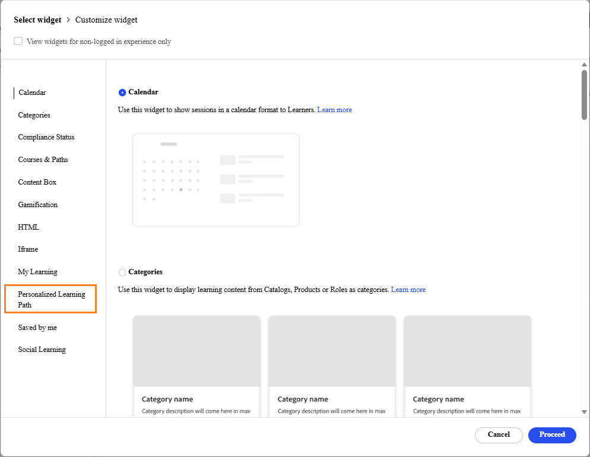

# Branding per l’amministratore: riposizionamento delle strisce PLP e VC della pagina principale

## Aggiungere e riordinare le strisce della pagina principale in Adobe Learning Manager

Aggiungi strisce Percorso di apprendimento personalizzato e Istruzioni virtuali alla pagina principale dell’Allievo, quindi trascina e rilascia le strisce per impostare l’ordine visualizzato dagli Allievi.

In qualità di Amministratore, puoi aggiungere strisce del percorso di apprendimento personalizzato (PLP) e delle istruzioni virtuali alla pagina principale dell’Allievo in Adobe Learning Manager. Puoi anche riordinare ogni striscia della pagina principale con i controlli di trascinamento in **Admin Branding**. Ora puoi decidere quali strisce visualizzare per primi gli Allievi.

Puoi anche aggiungere un widget Percorso di apprendimento personalizzato a una pagina personalizzata.

### Informazioni sulle strisce della pagina principale

Le strisce della pagina principale sono i widget (schede) visualizzati nella pagina principale dell’Allievo. Con Admin Branding puoi controllare quali strisce vengono visualizzate e in che ordine. Nella versione di dicembre 2026 di ALM, sono disponibili due strisce basate sull&#39;intelligenza artificiale:

* **Striscia Percorso di apprendimento personalizzato:** evidenzia i percorsi di apprendimento generati dall&#39;intelligenza artificiale per ogni Allievo.
* **Istruzione virtuale:** consente agli Allievi di trovare e aprire le esperienze di coaching dalla pagina principale.

### Striscia del percorso di apprendimento personalizzato

Gli Allievi possono utilizzare la striscia per:

* Accedi ai percorsi di apprendimento generati dall’intelligenza artificiale.
* Continua i percorsi di apprendimento generati in precedenza.
* Scopri i percorsi di apprendimento consigliati.

### Striscia di istruzioni virtuale

Gli Allievi possono utilizzare la striscia per:

* Scopri le esperienze di Virtual Coach.
* Riprendi le attività di coaching.
* Inizia il coaching di intelligenza artificiale conversazionale dalla pagina principale.

### Riordina le strisce della pagina principale

Potete posizionare qualsiasi striscia in qualsiasi posizione. Ad esempio, puoi mostrare prima la striscia degli allenatori virtuali, poi le strisce **Percorsi di apprendimento personalizzati** e **Catalogo** e infine **Visualizzati di recente**.

1. Nell&#39;app di amministrazione, seleziona **Configura** > **Branding** nel riquadro di navigazione a sinistra.

   

2. Seleziona **Home page Allievo**.
3. Nell’elenco delle strisce, individuate la striscia da spostare.
4. Trascinate la striscia nella nuova posizione.

   

5. Salva le modifiche.

Dopo la pubblicazione, il nuovo ordine viene visualizzato nella pagina principale dell’Allievo.

>[!NOTE]
>
>Se la striscia Percorso di apprendimento personalizzato o Istruzione virtuale non è presente nell’elenco, assicurati che sia stata aggiunta alla configurazione della pagina principale prima di riordinarla.

## Aggiungere un widget Percorso di apprendimento personalizzato a una pagina personalizzata

È possibile utilizzare il widget Percorso di apprendimento personalizzato all’esterno della pagina principale. Aggiungilo a una pagina personalizzata per offrire agli Allievi uno spazio dedicato per trovare consigli di apprendimento personalizzati.

1. Seleziona **Pagine personalizzate**.
2. Crea una pagina o modifica una pagina esistente.
3. Aggiungi un widget **Percorso di apprendimento personalizzato**.

   

   Rivedete il widget.

   

4. Seleziona **Procedi**.
5. Aggiungi il titolo e la descrizione del widget.

   

6. Seleziona **Aggiungi widget**.
7. Salva la pagina.
8. Publish la pagina.
