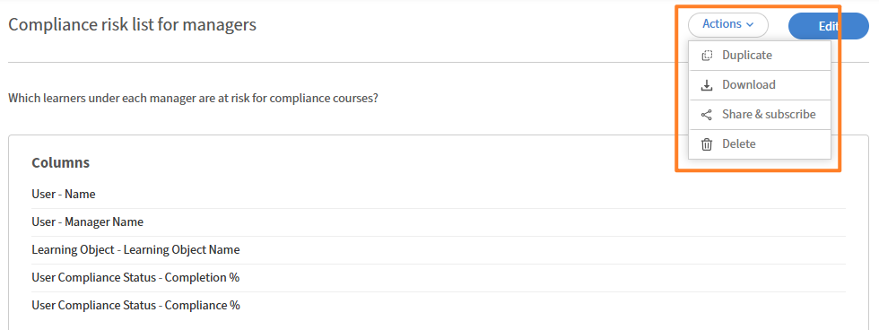

# Creare un report personalizzato nel Report Builder

## Panoramica

La creazione da zero funziona meglio se disponi di un’immagine chiara delle colonne e dell’output necessari e se nessun modello esistente corrisponde al tuo caso d’uso. Se non conosci Report Builder, inizia con un modello.

## Creare un report personalizzato

In questo esempio, identificherai gli Allievi a rischio di corsi sulla conformità alla guida di ciascun Manager.

1. Accedi a Adobe Learning Manager come amministratore.
2. Seleziona **Report**, quindi seleziona **Report Builder**.
3. Seleziona la scheda **Report**, quindi seleziona **Crea report**.
4. Inserire un nome per il rapporto. È necessario specificare un nome. Se necessario, inserire una descrizione.

   

5. Nel pannello colonna, selezionate i seguenti set di dati ed espandeteli:

   * Utente
   * Oggetto di apprendimento
   * Stato conformità utente

6. Selezionare **+** accanto alle colonne da includere. Le colonne selezionate vengono visualizzate nell&#39;area di lavoro del report.

   * Utente - Nome
   * Nome utente - Manager
   * Oggetto di apprendimento: nome dell’oggetto di apprendimento
   * Stato conformità utente - % completamento
   * Stato conformità utente - % conformità

   

7. Riordinate le colonne trascinandole nell&#39;area di lavoro.
8. Per rinominare una colonna, immettere un nome nel campo **Alias** della colonna. Se si specifica un alias, l&#39;alias viene utilizzato come intestazione di colonna. Se non si specifica un alias, l&#39;intestazione di colonna predefinita include il nome del set di dati. Ad esempio, il nome del set di dati dell’oggetto di apprendimento viene visualizzato come Oggetto di apprendimento - Nome.

   **Intestazioni colonna**

   Report Builder include il nome del set di dati nelle intestazioni di colonna predefinite per consentire di distinguere le colonne con nomi simili tra i set di dati. Ad esempio, se selezioni Nome dal set di dati dell’oggetto di apprendimento, l’intestazione di colonna viene visualizzata come Oggetto di apprendimento - Nome.

   Se si specifica un alias personalizzato per una colonna, Report Builder utilizza l&#39;alias anziché l&#39;intestazione di colonna predefinita.

   **Impatto sui report esistenti**

   Dopo l&#39;aggiornamento, i report esistenti che utilizzano nomi di colonna predefiniti senza alias personalizzati visualizzano le intestazioni di colonna aggiornate. Ad esempio, il nome del set di dati dell’oggetto di apprendimento passa da Nome a Oggetto di apprendimento - Nome.

   I dati dei report, i filtri e le pianificazioni non sono interessati.

   Se si utilizza l&#39;output del report in script, fogli di calcolo, dashboard BI o integrazioni che fanno riferimento a colonne per intestazione, controllare i sistemi downstream e aggiornare i riferimenti alle intestazioni di colonna precedenti in base alle esigenze.

   Per mantenere un&#39;intestazione di colonna specifica, impostare un alias personalizzato per la colonna.

9. Seleziona **Salva report**.

## Scarica il report

1. Seleziona **Azioni** nell&#39;angolo superiore destro.

   

2. Seleziona **Scarica**. Puoi scaricare il report dall&#39;icona delle notifiche quando è pronto.

Il report scaricato (csv) contiene le seguenti colonne:

* nome
* managerName
* nome
* completedPct
* compliancePct

## Applicare raggruppamento, filtri e ordinamento

### Filtro

Ora che hai scaricato il report, applica un filtro in cui completionPct O compliancePct è uguale a 100.

1. Apri il report e seleziona **Modifica** nell&#39;angolo superiore destro.
2. Selezionare **Aggiungi filtro** ed eseguire la ricerca nelle colonne in cui si desidera applicare i filtri.

   

3. Seleziona **Aggiungi**.
4. Combinate i filtri con logica AND/OR; selezionate l&#39;operatore per passare da una riga all&#39;altra.

   

5. Seleziona **Salva report** e scarica il report.

Il report scaricato contiene record in cui completionPct O compliancePct è uguale a 100.

### Raggruppa per

Raggruppa i record per responsabile in modo da:

* Aggregazione dei dati degli Allievi per Manager
* Calcola medie a livello di manager
* Conteggio degli Allievi in ciascun Manager

1. Apri il report e seleziona **Modifica** nell&#39;angolo superiore destro.
2. Seleziona **Raggruppa per:Select** e seleziona la colonna **Nome utente-manager**.

   

3. Aggregare le seguenti colonne:

   * User-Name
   * Oggetto di apprendimento - Nome dell’oggetto di apprendimento

4. Selezionare **Count** come funzione di aggregazione per le colonne.

   

   **Intestazioni di colonna per le colonne aggregate:**

   Quando si applica una funzione di aggregazione, l&#39;intestazione di colonna predefinita include la funzione di aggregazione. Ad esempio, quando applichi **Count** a **Oggetto di apprendimento - ID**, l’intestazione di colonna viene visualizzata come **Count** di **Oggetto di apprendimento - ID**. Se è stato specificato un alias personalizzato, l&#39;alias rimane invariato.

5. Ripeti per Oggetto di apprendimento - Nome oggetto di apprendimento.

   

6. Seleziona **Salva report** e scarica il report.

Il report scaricato contiene un riepilogo delle prestazioni di formazione degli Allievi per i Manager. Mostra i tassi medi di completamento, i punteggi medi di conformità e i conteggi totali degli Allievi per ogni Manager. I dati indicano il completamento della formazione universale in tutti i gruppi, mentre le prestazioni di conformità variano in modo significativo tra i manager.

### Ordina

Ordina il report in ordine decrescente in base al numero di Allievi per ogni Manager.

1. Apri il report e seleziona **Modifica** nell&#39;angolo superiore destro.
2. Selezionare **Aggiungi ordinamento**.
3. Cerca il nome utente e seleziona **Nome-utente**.
4. Selezionare **Decrescente**.

   

5. Seleziona **Aggiungi**.
6. Seleziona **Salva report** e scarica il report.

Il report scaricato contiene il numero di Allievi per Manager in ordine decrescente.
