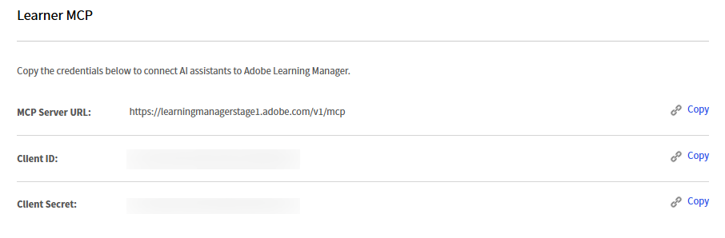

# Configurare un server Model Context Protocol

In qualità di amministratore, puoi creare un server, copiarne le credenziali e assegnarle all’amministratore del client AI che completa la connessione. Potete visitare nuovamente un server in qualsiasi momento per modificarlo, aggiornarne gli strumenti, copiarne le credenziali, modificarne lo stato o eliminarlo.

## Creare il server MCP

1. Accedi a Adobe Learning Manager come amministratore.
2. Passa a **AI in Learning** \> **Server MCP**.
3. Selezionare **Nuovo server MCP**.
4. Immettere i dettagli del server, inclusa una descrizione.

   * **Nome server:** Immettere un nome composto da un massimo di 50 caratteri.
   * **Descrizione:** Immettere una breve descrizione di massimo 150 caratteri.
   * **URL:** Immettere l&#39;URL dell&#39;azienda o dell&#39;applicazione.
   * **Domini di reindirizzamento:** Immettere il dominio di ogni client di intelligenza artificiale che si connetterà, ad esempio [http://\*.chatgpt.com](https://encoded-592c9deb-987b-4562-aa3c-9fa3d37d83e9.uri/http%3a%2f%2f*.chatgpt.com) o [http://\*.claude.ai](https://encoded-592c9deb-987b-4562-aa3c-9fa3d37d83e9.uri/http%3a%2f%2f*.claude.ai). Questo campo è obbligatorio.

     

5. Seleziona **Avanti**.
6. Nella pagina **Strumenti disponibili**, esamina gli strumenti per gli allievi esposti dal server. Fornire descrizioni dettagliate, contestuali e specifiche per gli strumenti MCP. Le descrizioni ben scritte degli strumenti consentono ai client compatibili con MCP di individuare e richiamare gli strumenti appropriati con maggiore precisione. Include lo scopo dello strumento, le attività supportate, gli input previsti e i casi d&#39;uso tipici. Descrizioni chiare e concise migliorano la selezione degli strumenti e l’esperienza complessiva dell’utente quando gli Allievi interagiscono con gli Assistenti AI.

   

   Seleziona **Visualizza** per ciascuno strumento per visualizzare le istruzioni che indicano quando è selezionato e come risponde lo strumento.

   

7. Seleziona **Credenziali client** nel riquadro di navigazione a sinistra.
8. Copia l&#39;**URL endpoint MCP**, l&#39;**ID client** e la **chiave privata**. Selezionare **Copia** accanto a ogni valore.

   

9. Selezionare **Chiudi**.

>[!NOTE]
>
>Il server fornisce accesso in lettura solo agli utenti con il ruolo di Allievo.

Fornisci l&#39;URL dell&#39;endpoint, l&#39;ID client e la chiave segreta all&#39;amministratore del client AI.

## Modificare la descrizione di uno strumento

Una descrizione dello strumento indica al client AI quando selezionare lo strumento e come risponde. Potete anche aggiungere degli esempi di prompt. Le descrizioni ben scritte degli strumenti consentono ai client compatibili con MCP di individuare e richiamare gli strumenti appropriati con maggiore precisione. Include lo scopo dello strumento, le attività supportate, gli input previsti e i casi d&#39;uso tipici.

1. Nella pagina **Strumenti disponibili**, selezionate il menu **Azioni** per uno strumento.
2. Selezionare **Configurazione strumento MCP** \> **Modifica**.

   

3. Nella finestra di dialogo **Strumento di modifica**, aggiornare **Istruzioni/Descrizione**.

   

4. In **Suggerimenti di esempio**, modificare i prompt. Per aggiungere una richiesta, seleziona **Aggiungi un altro esempio**.
5. Seleziona **Salva**.

Per ripristinare la formulazione originale di uno strumento, selezionate il menu **Azioni** per lo strumento, quindi selezionate **Configurazione strumento MCP** \> **Ripristina**.

## Modificare un server MCP

1. Seleziona **AI in Learning** \> **Server MCP**.
2. Selezionare il nome del server.
3. Seleziona **Modifica**.
4. Aggiorna i campi nella pagina **Dettagli applicazione** e salva le modifiche.

## Eliminare un server MCP

1. Seleziona **AI in Learning** \> **Server MCP**.
2. Nella riga del server, seleziona il menu **Azioni**.
3. Selezionare **Elimina**.
4. Nella finestra di dialogo di conferma, seleziona **Elimina**.

>[!WARNING]
>
>L&#39;eliminazione di un server rimuove l&#39;accesso a tutti i suoi strumenti per le applicazioni di intelligenza artificiale connesse. Le sessioni attive potrebbero smettere di funzionare immediatamente e non è possibile annullare l&#39;eliminazione.

## Risoluzione dei problemi

**Le modifiche apportate allo strumento non vengono visualizzate immediatamente.**
L&#39;applicazione delle modifiche alle descrizioni degli strumenti richiede del tempo. Attendi e riprova.

**Un client AI ha smesso di funzionare dopo l&#39;eliminazione di un server.**
Create un nuovo server e assegnate le nuove credenziali all&#39;amministratore del client AI.

**Il client AI utilizza lo strumento errato.**
Esaminare le descrizioni degli strumenti modificate. Utilizzare **Ripristina** per ripristinare la formulazione originale.

## Procedure ottimali

* Conservare le descrizioni originali degli strumenti a meno che non si abbia un motivo specifico per modificarle.
* Scrivete descrizioni chiare e specifiche degli strumenti e richiedete conferma se le modificate.
* Archivia la chiave segreta in modo sicuro e condividila solo con l&#39;amministratore del client AI.
* Create un server separato per ciascuna applicazione di intelligenza artificiale in modo da poterne eliminare uno senza influire sugli altri.
* Prima di eliminarla, verificate che nessuna applicazione basata su IA dipenda da un server.
