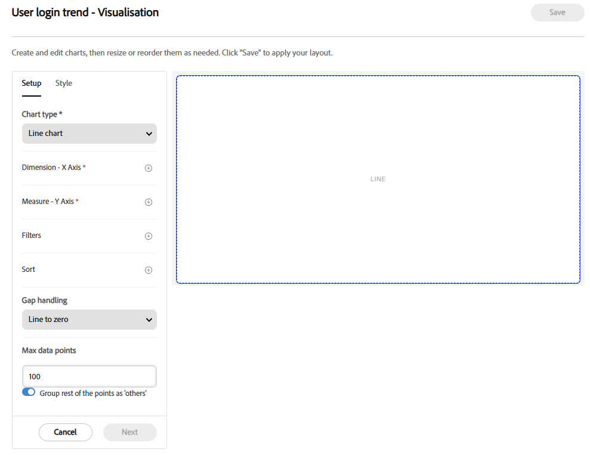
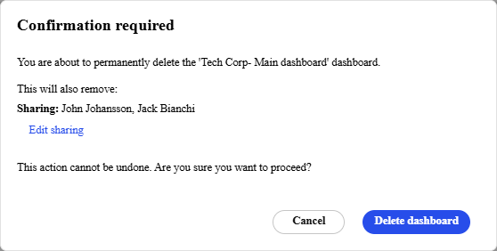

# Visualizzazioni nel Report Builder

Le visualizzazioni nel Report Builder Adobe Learning Manager trasformano un report salvato in grafici e dashboard. È possibile confrontare gruppi, tendenze delle tinte piatte e condividere risultati senza rimodellare i dati con uno strumento per fogli di calcolo.

>[!IMPORTANT]
>
>Le visualizzazioni (grafici e dashboard) in Report Builder sono disponibili solo per i clienti di Adobe Learning Manager Ultimate. Non sono disponibili con l&#39;edizione Prime.

## Informazioni sulle visualizzazioni in Report Builder {#about-visualizations}

Per visualizzazione si intende un grafico o un dashboard di grafici creato a partire da un report salvato in Report Builder. È possibile scegliere le colonne del report da tracciare e Report Builder disegna il grafico dai dati del report. È possibile tracciare le colonne direttamente o tracciare i dati riepilogati da un rapporto.

* **Creare grafici per un report:** Aprire il report, selezionare **Visualizzazione** e creare grafici. Vedere [Creare un grafico da un report](#create-chart-from-report).
* **Raggruppare i grafici in un dashboard:** Scegliere i report come origine dati e quindi aggiungere i grafici. Vedere [Creare un dashboard](#build-dashboard).
* **Condividere e visualizzare:** condividere un dashboard con gli amministratori, che lo visualizzano e lo filtrano in modalità di sola lettura.

I grafici funzionano in due modalità:

* **Modalità di configurazione:** Il grafico viene creato o modificato.
* **Modalità visualizzazione:** è possibile filtrare gli elementi visualizzati nel grafico senza modificare la modalità di compilazione.

## Tipi di grafico e quando utilizzarli {#chart-types}

Scegliere il tipo di grafico in base alla domanda a cui si desidera rispondere.

| Tipo di grafico | Utilizzalo per | Esempio |
|---|---|---|
| LINE | Mostra il modo in cui un valore cambia nel tempo. | Iscrizioni per mese di creazione |
| Barra o colonna | Confronta i valori tra le categorie. Sono disponibili layout raggruppati, in pila e in pila al 100%. | Allievi per stato di iscrizione |
| Torta | Mostra la quota di ogni categoria dell&#39;intero. I segmenti inferiori all&#39;1% sono raggruppati in un segmento **Altri**. | Iscrizioni per catalogo |
| Numero grande | Evidenziare una metrica chiave. | Completamenti totali di questo trimestre |
| Tabella | Mostra i valori esatti. È possibile scegliere un sottoinsieme di colonne e visualizzare una colonna della data come righe anziché come colonne (visualizzazione da colonna a riga). | Tempo di apprendimento impiegato per utente, al mese |

>[!NOTE]
>
>I grafici a linee creati dai report sulle tendenze, ad esempio le iscrizioni per mese, mostrano lo snapshot corrente dei dati raggruppati per data. Non mostrano come i dati analizzavano ogni data passata. Per ulteriori informazioni, vedere Concetti e terminologia di Report Builder.

## Termini di visualizzazione {#visualization-terms}

| Durata | Significato |
|---|---|
| Report | Una configurazione di Report Builder salvata di colonne, filtri e raggruppamenti. I grafici vengono creati dai report. |
| Filtro a livello di grafico | Filtro impostato durante la creazione o la modifica di un grafico. Limita i dati tracciati dal grafico. |
| Filtro a livello di pagina | Filtro applicato da un visualizzatore a tutti i grafici di una pagina o dashboard. Può restringere, ma non ampliare, i filtri del report stesso. |
| Dashboard Report Builder | Pagina di grafici creati in Report Builder. |

## Creare un grafico da un report {#create-chart-from-report}

Crea un grafico da un report salvato per visualizzare immediatamente i dati relativi a iscrizione, completamento o tempo impiegato. Il grafico viene configurato una volta e viene ricavato dai dati del report ogni volta che viene aperto.

### Prima di creare un grafico {#before-you-create-chart}

Conferma quanto segue:

* **Salvare il report.** L&#39;opzione per aggiungere un grafico viene visualizzata nella pagina Report Builder dopo il salvataggio del report.
* **Utilizza il tuo report.** Duplicare un report condiviso per creare una copia personalizzata e quindi utilizzarlo per creare grafici.
* **Controllare le dimensioni.** Impossibile tracciare un report con più di 10 milioni di righe. Un report riepilogativo con più di 10.000 punti dati non viene tracciato. Consulta Limiti del grafico e del dashboard.
* **Conoscere le colonne.** L&#39;asse X (dimensione) e l&#39;asse Y (misura) del grafico derivano dalle colonne del report. Per riepilogare il report stesso, utilizzare **Raggruppa per** e aggregare. Per ulteriori informazioni, vedere Applicare raggruppamenti e aggregazioni.

### Configurare un grafico {#configure-chart}

1. Accedi a Adobe Learning Manager come Amministratore.
1. Seleziona **Report**, quindi seleziona **Report Builder**.
1. Seleziona la scheda **Report** e apri un report salvato. In questo esempio, seleziona un report sull’andamento degli accessi degli utenti, che mostra il numero di utenti che hanno effettuato l’accesso alla piattaforma di apprendimento in ogni data.
1. Nella barra di navigazione a sinistra, seleziona **Visualizzazione**. Viene aperto un pannello con le schede **Configurazione** e **Stile**.

   

   >[!NOTE]
   >
   >Dopo l&#39;esistenza di un grafico, selezionare **Modifica**, quindi selezionare **+** per aggiungere un altro grafico.

1. In **Tipo di grafico**, selezionare un tipo, ad esempio **Grafico a linee**. Questo campo è obbligatorio.
1. Accanto a **Dimension - Asse X**, selezionare l&#39;icona di aggiunta, quindi selezionare la colonna del report. Per una colonna della data, selezionare anche **Granularità data**, ad esempio giorno o mese.

   {width="650"}

1. Selezionare **Aggiungi** per aggiungere la dimensione data.
1. Accanto a **Misura - Asse Y**, selezionare l&#39;icona Aggiungi, quindi selezionare la colonna del report e la modalità di aggregazione, ad esempio **Conteggio**.

   {width="650"}

1. Selezionare **Aggiungi** per aggiungere la misura.
1. (Facoltativo) Selezionare **Aggiungi filtro** per limitare i dati tracciati a un intervallo, ad esempio gli ultimi 30 giorni. Seleziona **Aggiungi**.

   {width="650"}

1. (Facoltativo) Aggiungere una colonna **Ordinamento**, quindi selezionare **Crescente** o **Decrescente**. Seleziona **Aggiungi**.

   {width="650"}

1. (Facoltativo) Per un grafico a linee, impostare **Gestione aperture** per i dati mancanti. Per i dati mancanti, vedere [Gestione delle aperture](#gap-handling).
1. In **Numero massimo di coordinate**, immettere il numero di coordinate da tracciare nel grafico. Il valore predefinito è 100 punti e il limite è 10.000.
1. Attiva **Raggruppa i punti come &#39;altri&#39;**. Nel Report Builder vengono visualizzati singoli punti dati fino al valore **Numero massimo di punti dati** e tutti gli elementi oltre tale limite vengono combinati in una categoria aggiuntiva denominata **Altri**.

   Ad esempio, se **Numero massimo di coordinate** è 150 e la query restituisce 200 punti:

   * Report Builder visualizza 150 punti singolarmente.
   * Report Builder combina i restanti 50 punti in **Altri**.
   * Il grafico mostra 151 punti tracciati: 150 più **Altri**.

1. Seleziona **Avanti**. È ora possibile personalizzare il grafico.

   {width="650"}

#### Gestione delle lacune per i dati mancanti {#gap-handling}

La gestione delle aperture definisce le operazioni eseguite dal grafico quando una o più osservazioni di una serie non hanno un valore numerico, ad esempio NULL, NA, NaN o una cella vuota.

Si supponga che i dati siano:

| X | Valore |
|---|---|
| Gen | 10 |
| Feb | 15 |
| mar | N/D |
| Apr | N/D |
| Maggio | 25 |

Nella tabella seguente vengono illustrati i tre comportamenti.

| Gestione delle aperture | Risultato concettuale | Come viene tracciato |
|---|---|---|
| Riga a zero | `10 -> 15 -> 0 -> 0 -> 25` | I valori mancanti vengono trattati come 0. |
| Salta | `10 -> 15   25` | Non esegue il plottaggio dei punti mancanti e interrompe la linea. |
| Connetti | `10 -> 15 ----> 25` | Non esegue il plottaggio dei punti mancanti, ma collega le osservazioni valide su entrambi i lati. |

>[!NOTE]
>
>Connessione non interpolata. Se Marzo e Aprile non sono presenti, il collegamento diretto di Febbraio a Maggio disegna solo una linea visiva tra i due valori noti. Non vengono creati i valori effettivi di marzo e aprile.

### Personalizzare il grafico {#customize-chart}

Personalizzare un grafico per renderlo chiaro e di facile lettura. Nella scheda **Stile** è possibile aggiungere un titolo, mostrare o nascondere i titoli e le legende degli assi, posizionare e allineare la legenda e impostare un colore per ogni serie. Le modifiche allo stile influiscono solo sull&#39;aspetto del grafico. Non cambiano i dati tracciati.

1. Per visualizzare un titolo sopra il grafico, selezionare **Mostra titolo per il grafico**. Per nasconderlo, disattiva l&#39;opzione.
1. In **Titolo grafico**, immettere un titolo per il grafico.
1. Selezionate **Mostra titolo per asse X** e **Mostra titolo per asse Y** per assegnare un&#39;etichetta agli assi.
1. Per visualizzare una chiave che identifichi ogni riga, selezionare **Mostra legende**.
1. In **Posizione legenda**, seleziona l&#39;icona sinistra, centrale o destra per allineare la legenda.
1. In **Colore linea**, seleziona il campione di colore accanto a una serie, ad esempio **Numero di utenti**.
1. Nel selettore colore, scegliete un colore dalla tavolozza oppure usate la scheda personalizzata per definire un colore personale.
1. Ripetete i due passaggi precedenti per ogni linea da ricolorare.
1. Selezionare **Crea** per aggiungere il grafico. Se stai modificando un grafico esistente, seleziona **Salva**.

   {width="650"}

Il grafico viene visualizzato con i titoli, la legenda e i colori delle linee.

>[!TIP]
>
>* Scegli i colori che contrastano chiaramente tra loro e con lo sfondo. Mantieni i titoli e la legenda accesi in modo che il colore non sia l&#39;unico modo per distinguere le linee.
>* Le opzioni **Posizione legenda**, **Allineamento legenda** e **Colore linea** sono valide solo quando è attivata l&#39;opzione **Mostra legende**.
>* Ogni linea del grafico ha un proprio campione, uno per ogni misura aggiunta nella scheda **Configurazione**.

Per disporre i grafici su una singola pagina, vedere [Creare un dashboard](#build-dashboard).

## Creare un grafico a torta {#create-pie-chart}

Usa un grafico a torta per mostrare come un intero si divide in parti, ad esempio la quota di dipendenti che hanno completato la formazione obbligatoria o la combinazione dei formati del corso. Ogni sezione mostra la quota di una categoria sul totale.

### I grafici a torta {#about-pie-charts}

Un grafico a torta disegna una sezione per categoria. Le dimensioni della sezione indicano la quota di quella categoria rispetto alla misura totale. Una legenda identifica ogni sezione e ogni sezione ne visualizza il valore.

Utilizzare un grafico a torta per mostrare parti di un intero in poche categorie, quando gli spettatori hanno bisogno di proporzione superiore ai valori esatti. Per confrontare più categorie, utilizzare un grafico a barre. Per visualizzare le modifiche nel tempo, utilizzare un grafico a linee.

### Passaggi per creare un grafico a torta {#pie-chart-steps}

Prima di iniziare, salvare un report di tua proprietà. Includere una colonna per le categorie e una colonna da misurare.

1. Seleziona **Report**, quindi seleziona **Report Builder**. Nella scheda **Report** aprire il report salvato.
1. Nella barra di navigazione a sinistra, seleziona **Visualizzazione**.
1. In **Tipo di grafico**, selezionare **Grafico a torta**.
1. Accanto a **Dimension - Segmento**, selezionare l&#39;icona di aggiunta, quindi selezionare la colonna che definisce le sezioni. Ad esempio, seleziona **Trascrizione (Oggetto di apprendimento) - Stato**.
1. Accanto a **Misura - Valore**, selezionare l&#39;icona di aggiunta, quindi selezionare la colonna e aggregare le dimensioni delle sezioni, ad esempio **Conteggio**.
1. (Facoltativo) In **Numero massimo di coordinate**, immettere il numero massimo di sezioni da disegnare. Il valore predefinito è 100.
1. (Facoltativo) Per combinare categorie secondarie, attiva **Raggruppa i punti come &#39;altri&#39;**.
1. Seleziona **Avanti** per personalizzare il grafico a torta.

### Personalizzare il grafico a torta {#customize-pie-chart}

1. Per visualizzare un titolo, attivare **Mostra titolo per il grafico**. Disattivalo per nascondere il titolo.
1. In **Titolo grafico**, immettere un titolo, ad esempio `Mandatory Compliance Completion`.
1. In **Stile grafico**, selezionare **Torta** per un cerchio pieno o **Ciambella** per un anello.
1. Selezionare **Mostra legende** per visualizzare la legenda nel grafico.
1. In **Posizione legenda**, selezionare la posizione in cui viene visualizzata la legenda.
1. In **Allineamento legenda**, selezionare sinistra, centro o destra.
1. Selezionare **Crea** per un nuovo grafico. Quando modifichi un grafico esistente, seleziona **Salva**, quindi seleziona **Salva** nella pagina **Visualizzazione**.

   {width="650"}

Report Builder crea il grafico a torta o a ciambella.

## Creare un grafico a barre {#create-bar-chart}

Utilizza un grafico a barre per confrontare una misura tra categorie, ad esempio lo stato della formazione per team o il tempo di apprendimento per cliente. Le barre sono facili da confrontare e classificare ed è possibile raggrupparle o impilarle per aggiungere una seconda suddivisione.

### Informazioni sui grafici a barre {#about-bar-charts}

Un grafico a barre disegna una barra per ogni categoria sull&#39;asse X. La lunghezza della barra indica la misura sull’asse Y, ad esempio il numero di allievi. È possibile disegnare barre in verticale (colonne) o in orizzontale.

Utilizzare un grafico a barre per:

* Confronta i valori tra categorie, ad esempio team, partner o clienti.
* Classifica le categorie dalla più alta alla più bassa.
* Mostra una seconda suddivisione all&#39;interno di ciascuna barra, ad esempio lo stato all&#39;interno di ciascun partner.

### Prima di creare un grafico a barre {#before-you-create-bar-chart}

* Salva il report e utilizza un report di tua proprietà.
* Includere una colonna per le categorie e una colonna da misurare.
* Mantenere il report entro i limiti indicati in Grafico e dashboard.

### Procedura per creare un grafico a barre {#bar-chart-steps}

1. Seleziona **Report**, quindi seleziona **Report Builder**. Nella scheda **Report** aprire il report salvato.
1. Nella barra di navigazione a sinistra, seleziona **Visualizzazione**.
1. In **Tipo di grafico**, selezionare **Grafico a barre**.
1. Accanto a **Dimension - Asse X**, selezionare l&#39;icona Aggiungi, quindi selezionare la colonna che definisce le categorie. Seleziona **Fine**.

   {width="650"}

1. Accanto a **Misura - Asse Y**, selezionare l&#39;icona Aggiungi, quindi selezionare la colonna e la modalità di aggregazione, ad esempio **Conteggio**. Seleziona **Fine**.

   {width="650"}

1. (Facoltativo) Aggiungere **Filtri** per limitare i dati e impostare **Ordina** per ordinare le barre in base a una colonna.
1. In **Numero massimo di coordinate**, immettere il numero massimo di coordinate da tracciare. Se si immettono 150, Report Builder visualizza fino a 150 singoli punti dati e combina tutti gli elementi oltre tale limite in un&#39;altra categoria denominata **Altri**.
1. Selezionare **Avanti** per personalizzare il grafico a barre.

### Personalizzare il grafico a barre {#customize-bar-chart}

Utilizzare la scheda **Stile** per impostare il titolo, l&#39;orientamento, il raggruppamento, la legenda e i colori. Le impostazioni di stile cambiano l&#39;aspetto del grafico, non i dati tracciati.

1. Seleziona la scheda **Stile**.
1. Per visualizzare un titolo, attivare **Mostra titolo per il grafico**. In **Titolo grafico**, immettere un titolo, ad esempio `Most Popular Courses`.
1. Per etichettare gli assi, attivare **Mostra titolo per asse X** e **Mostra titolo per asse Y**. Disattiva un&#39;opzione per nascondere il titolo.
1. In **Stile grafico**, selezionare **Verticale** per le colonne o **Orizzontale** per le barre laterali. Le barre orizzontali lasciano più spazio per i nomi di categoria lunghi.
1. Nel **Raggruppamento barre**, selezionare una delle tre icone per impostare la modalità di condivisione di una categoria da parte di più serie: raggruppata, in pila o in pila al 100%.
1. Per identificare ogni serie, attivare **Mostra legende**.
1. In **Posizione legenda**, selezionare la posizione in cui viene visualizzata la legenda. In **Allineamento legenda**, selezionare sinistra, centro o destra.
1. In **Colore barra**, seleziona il campione accanto a una serie, quindi scegli un colore.
1. Selezionare **Crea** per un nuovo grafico. Quando modifichi un grafico esistente, seleziona **Salva**.

>[!NOTE]
>
>Il raggruppamento di **barre** è importante solo quando una barra ha più di una serie, ad esempio due misure. Mantenere la legenda attiva e visualizzare le etichette dati, in modo che il colore non sia l&#39;unico modo per distinguere le serie.

## Crea un numero grande {#create-big-number}

Utilizzare un numero elevato per visualizzare una metrica chiave come valore grande e di facile lettura, ad esempio il totale degli Allievi, le iscrizioni scadute o gli utenti attivi. I grandi numeri funzionano bene nella parte superiore di un dashboard, dove gli spettatori controllano prima le figure chiave.

### I grandi numeri {#about-big-numbers}

Un numero grande è una porzione con due parti: un valore e un&#39;etichetta. Il valore è un singolo numero calcolato dal report, ad esempio un conteggio o una somma. L&#39;etichetta indica agli spettatori il significato del numero. Un numero grande non ha assi, legenda o categorie.

Utilizza un numero grande per:

* Mostrare un titolo che viene controllato regolarmente.
* Fornire contesto a un dashboard prima dei grafici dettagliati sottostanti.

### Passaggi per creare un numero grande {#big-number-steps}

Prima di iniziare, salvare un rapporto di tua proprietà. Stabilire il numero desiderato e la colonna e l&#39;aggregazione da cui produrlo.

Ad esempio, gli Amministratori della formazione segnalano ogni mese in che misura la formazione è stata completata dall’organizzazione. I responsabili desiderano un titolo, non un elenco di iscrizioni, e gli amministratori desiderano aggiornarlo senza ricompilare il report.

1. Seleziona **Report**, quindi seleziona **Report Builder**. Nella scheda **Report** aprire il report salvato.
1. Nella barra di navigazione a sinistra, seleziona **Visualizzazione**.
1. In **Tipo di grafico**, selezionare **Numero elevato**.
1. In **Misura - Valore**, selezionare **Trascrizione (oggetto di apprendimento) - Stato**, quindi applicare l&#39;aggregazione **Conteggio**. Seleziona **Fine**.

   {width="650"}

1. Selezionare il numero di cifre da visualizzare dopo la virgola decimale. Potete selezionare un massimo di due cifre.
1. In **Unità di visualizzazione**, selezionare la modalità di riduzione del numero. Seleziona **K** per migliaia, **M** per milioni, **B** per miliardi o **Nessuno** per visualizzare il valore completo. **Automatico** seleziona automaticamente l&#39;unità appropriata. Seleziona **Avanti**.

   {width="650"}

### Personalizza il grande numero {#customize-big-number}

Utilizza la scheda **Stile** per personalizzare le proprietà della legenda del numero grande.

1. In **Titolo legenda**, immetti il testo con il nome del numero. Ad esempio, immettere `Total Course Completions`.
1. In **Posizione legenda**, seleziona una delle due icone per impostare la posizione in cui verrà visualizzato il titolo.
1. In **Allineamento legenda**, selezionare sinistra, centro o destra.
1. Selezionare **Crea** per un nuovo grafico. Quando modifichi un grafico esistente, seleziona **Salva**.

   {width="650"}

## Creare una tabella o un grafico pivot {#create-table-pivot-chart}

Utilizzare una tabella pivot per riepilogare un numero tra due categorie, ad esempio il numero di allievi che hanno completato, iniziato o non hanno iniziato l’apprendimento richiesto all’interno del team di ogni manager. Puoi anche passare a una vista in stile pivot, in cui le date o le categorie vengono visualizzate nella parte superiore della tabella, in modo che ogni Allievo o corso si adatti a un’unica riga.

### Informazioni sui grafici a tabella e pivot {#about-table-pivot}

Una tabella pivot è una griglia con una categoria in basso sul lato, una categoria in alto e un numero in ogni cella. Ogni cella mostra la misura per un valore di riga e un valore di colonna. È possibile creare tre impostazioni nella scheda **Configurazione**.

| Impostazione | Che cosa fa | Nell&#39;esempio |
|---|---|---|
| **Dimension - Colonne** | I valori di questo campo diventano le intestazioni di colonna lungo la parte superiore. | **Trascrizione (Oggetto di apprendimento) - Stato**: Completata, In Corso, Non Avviata |
| **Dimension - Righe** | I valori di questo campo diventano le etichette di riga in basso a sinistra, una riga per ogni valore. | **Utente - Nome Manager** |
| **Misura - Valore** | Numero in ogni cella. Scegliere una colonna e un&#39;aggregazione, ad esempio **Count**. Viene visualizzato come nome di colonna seguito da **Aggregato da: Count**. | Numero di Allievi |

Una dimensione è un campo in base al quale viene eseguito il raggruppamento. Una misura è un numero che viene calcolato.

### Prima di creare un grafico a tabelle {#before-you-create-table-chart}

* Per utilizzare la visualizzazione da colonna a riga, raggruppare il report in base alla colonna desiderata come intestazioni, ad esempio una data.
* Se si esegue il raggruppamento in base a più colonne di data, selezionare una di esse per le intestazioni.

### Procedura per creare un grafico a tabelle {#table-chart-steps}

1. Seleziona **Report**, quindi seleziona **Report Builder**. Nella scheda **Report** aprire il report salvato.
1. Nella barra di navigazione a sinistra, seleziona **Visualizzazione**.
1. In **Tipo di grafico**, selezionare **Tabella / Pivot**.
1. Accanto a **Dimension - Righe**, selezionare l&#39;icona di aggiunta, quindi selezionare **Utente - Nome manager**.
1. Accanto a **Dimension - Colonne**, seleziona l’icona di aggiunta, quindi seleziona **Trascrizione (oggetto di apprendimento) - Stato**.
1. Accanto a **Misura - Valore**, selezionare l&#39;icona di aggiunta. Seleziona la misura **Trascrizione (oggetto di apprendimento) - Stato**, quindi seleziona **Aggiungi**.

   {width="650"}

1. Attiva una o entrambe le seguenti opzioni, in base ai tuoi requisiti di reporting:

   * **Mostra totale complessivo per le colonne:** Visualizza il totale complessivo per ogni colonna. Ad esempio, se nella tabella vengono visualizzati i dati relativi alle vendite in diverse aree geografiche, il totale complessivo mostra le vendite totali per ogni colonna.
   * **Mostra totale complessivo per le righe:** Visualizza il totale complessivo per ogni riga. Ad esempio, se nella tabella vengono visualizzate le vendite mensili tra prodotti diversi, il totale complessivo mostra le vendite totali per ogni riga.

1. In **Numero di righe da visualizzare (massimo 20)**, immettere il numero di righe da visualizzare nella tabella contemporaneamente. Il valore predefinito è 10 e il massimo è 20. Ad esempio, 15 visualizza 15 righe per pagina.
1. Seleziona **Avanti**.

### Personalizzare la tabella {#customize-table}

Utilizzare la scheda **Stile** per aggiungere il titolo del grafico, colorare l&#39;intestazione della tabella e colorare le righe della tabella.

1. In **Titolo grafico**, immettere il titolo che si desidera visualizzare, ad esempio `Status of Learning`.
1. Selezionare **Colore riga intestazione** per applicare un colore di sfondo alla riga di intestazione.
1. Attivate **Evidenzia righe alternative** per applicare colori alternati alle righe per semplificarne la lettura.
1. Selezionate **Colore 1** e scegliete il primo colore per le righe alternate.
1. Selezionare **Colore 2** e scegliere il secondo colore per le righe alternate.
1. Selezionare **Salva** per applicare le impostazioni di stile al grafico.

## Creare un dashboard {#build-dashboard}

In un dashboard i grafici di uno o più report vengono inseriti in una singola pagina. Creane uno quando rispondi ripetutamente alle stesse domande, ad esempio quante persone hanno completato il corso di formazione questo mese o quali team sono in ritardo.

### I dashboard di Report Builder {#about-dashboards}

Un dashboard è una pagina di grafici. È possibile scegliere i report da cui estrarre, denominandone l&#39;origine dati, e quindi aggiungere grafici da tali report. I grafici derivano sempre dai report, quindi è necessario crearli prima nella pagina **Visualizzazione** di ogni report. Puoi utilizzare solo i report di tua proprietà. L&#39;ambito viene applicato a ogni grafico del dashboard.

### Creare il dashboard {#create-dashboard}

1. Seleziona **Report** > **Dashboard**. Nella pagina sono elencati tutti i dashboard creati.
1. Seleziona **Crea dashboard**.
1. Immettere il nome e la descrizione del dashboard.

   {width="650"}

1. In **Origine dati**, selezionare **Aggiungi report** per aggiungere i grafici precreati dai report disponibili.
1. Seleziona uno o più report dall&#39;elenco, quindi seleziona **Aggiungi**.

   {width="650"}

Report Builder aggiunge i report al dashboard.

{width="650"}

### Visualizzare i grafici nel dashboard {#view-charts}

Selezionare **Grafici** nel riquadro di navigazione sinistro del dashboard.

{width="650"}

Tutti i grafici dei report disponibili vengono visualizzati nel dashboard.

{width="650"}

### Spostare i grafici nel dashboard {#move-charts}

1. Seleziona **Modifica** nell&#39;angolo superiore destro del dashboard. È possibile visualizzare le colonne di ogni report utilizzate per creare i grafici. È inoltre possibile creare un altro grafico da aggiungere al dashboard.

   {width="650"}

1. Nel pannello a sinistra, seleziona i grafici da aggiungere al dashboard.
1. Trascinare ciascun grafico nella posizione desiderata, quindi rilasciarlo per posizionarlo.
1. Ripetere il passaggio precedente per disporre i grafici in base ai requisiti di reporting.
1. Seleziona **Salva** per salvare tutte le modifiche nel dashboard.

### Condividere un dashboard {#share-dashboard}

Condividere una dashboard di Report Builder con altri amministratori in modo che possano visualizzare gli stessi grafici e dati.

I grafici creati da un report vengono salvati con tale report. Quando condividi il report, anche gli altri amministratori ottengono i grafici. Condividere una volta un dashboard invece di chiedere a ogni amministratore di rigenerarlo.

#### Condividere un dashboard con altri Amministratori {#share-with-administrators}

1. Accedi a Adobe Learning Manager come Amministratore.
1. Seleziona **Report**, quindi seleziona **Report Builder**.
1. Seleziona la scheda **Report** e apri il report che contiene il dashboard.
1. Selezionare **Azioni** > **Condividi**.
1. In **Condividi**, seleziona **Modifica**.
1. Seleziona il campo **Seleziona utenti/gruppi di utenti**.
1. Cerca e seleziona gli amministratori o i gruppi di utenti con cui desideri condividere le informazioni.

   {width="650"}

1. Seleziona **Salva**.

Gli amministratori selezionati possono ora visualizzare il report e i relativi grafici nella visualizzazione per Report Builder.

>[!NOTE]
>
>Gli amministratori con accesso condiviso possono visualizzare, duplicare e modificare il report.

#### Rimuovi accesso condiviso {#remove-shared-access}

1. Apri il report, quindi seleziona **Azioni** > **Condividi**.
1. In **Condividi**, seleziona **Modifica**.
1. Deseleziona Amministratore o gruppo di utenti.
1. Seleziona **Salva**.

#### Procedure consigliate per la condivisione {#sharing-best-practices}

* Condivisione di un report ben configurato invece di consentire a ciascun amministratore di creare una variazione. In questo modo viene mantenuta una versione autorevole dei dati.
* Crea il report con filtri applicabili a tutti gli utenti con cui lo condividi, in modo che tutti gli utenti vedano grafici coerenti.

### Eliminare un dashboard {#delete-dashboard}

Eliminare una dashboard di Report Builder quando non è più necessaria. Quando si elimina un dashboard, questo viene rimosso definitivamente con le relative impostazioni di condivisione. Questa operazione non può essere annullata.

1. Accedi a Adobe Learning Manager come Amministratore.
1. Seleziona **Report**, quindi seleziona **Report Builder**.
1. Seleziona la scheda **Report** e apri il dashboard da eliminare.
1. Selezionare **Azioni** > **Elimina**. Viene visualizzata la finestra di dialogo **Conferma richiesta**. Vengono visualizzati il nome del dashboard e gli utenti con cui è condiviso.

   {width="650"}

1. Selezionate una delle seguenti opzioni:

   * **Modifica condivisione:** rivedere o modificare gli utenti con cui è condiviso il dashboard.
   * **Annulla:** chiudere la finestra di dialogo senza eliminare il dashboard.
   * **Elimina dashboard:** eliminare definitivamente il dashboard e rimuovere le relative impostazioni di condivisione.