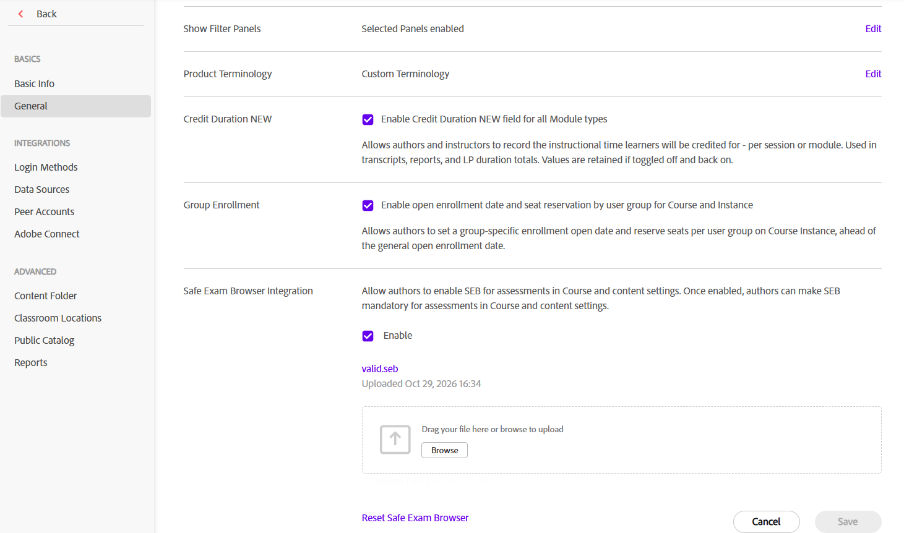

# Browser per esami sicuri

Il browser per esami sicuri fornisce un ambiente sicuro in cui gli allievi possono rispondere ai quiz nativi di Adobe Learning Manager limitando l’accesso ad altri browser e applicazioni durante una valutazione.

Gli amministratori possono abilitare l’integrazione Safe Exam Browser a livello di account e caricare un file di configurazione (.seb) per definire le restrizioni dei quiz. Una volta attivata l’integrazione, gli Autori possono configurare i singoli quiz per richiedere l’utilizzo del browser per esami sicuri.

Questo articolo spiega come abilitare l&#39;integrazione Safe Exam Browser per il tuo account.

## Abilita l’integrazione del browser per esami sicuri

Abilita l’integrazione Safe Exam Browser per rendere l’opzione disponibile agli Autori durante la configurazione dei quiz. Prima di iniziare, assicurati di disporre del file Browser esami sicuri per il tuo account.

Per abilitare l’integrazione del browser per esami sicuri:

1. Accedi ad ALM come **Amministratore**.
1. Selezionare **Impostazioni** > **Generali**.
1. Passa all&#39;**integrazione del browser per esami di sicurezza**.
1. Seleziona **Modifica**.

   Questa operazione espande l&#39;**integrazione del browser per esami di sicurezza**.

1. Seleziona **Abilita**.
1. Seleziona **Sfoglia** e carica il file del browser per esami sicuri dal sistema. Per ulteriori informazioni, visualizzare la configurazione del file del browser [Configura l&#39;esame sicuro](#configure-the-seb-file-for-macos).

   

1. Seleziona **Salva**.

   Il browser per esami sicuri è ora disponibile per gli Autori, da attivare durante la configurazione dei quiz supportati.

### Configurare il file .seb per macOS {#configure-the-seb-file-for-macos}

Create un file .seb utilizzando lo strumento di configurazione SEB per definire le restrizioni dei quiz, le impostazioni di sicurezza e le applicazioni consentite. Prima di utilizzare Safe Exam Browser (SEB), assicurarsi che il file .seb soddisfi i seguenti requisiti:

1. Impostare il parametro browserWindowWebView su 3 (valore Integer) per abilitare SEB.
1. Imposta startURL sull&#39;URL corrispondente all&#39;ambiente di destinazione.
1. Assicurati che il file .seb includa le informazioni quitURL richieste.
