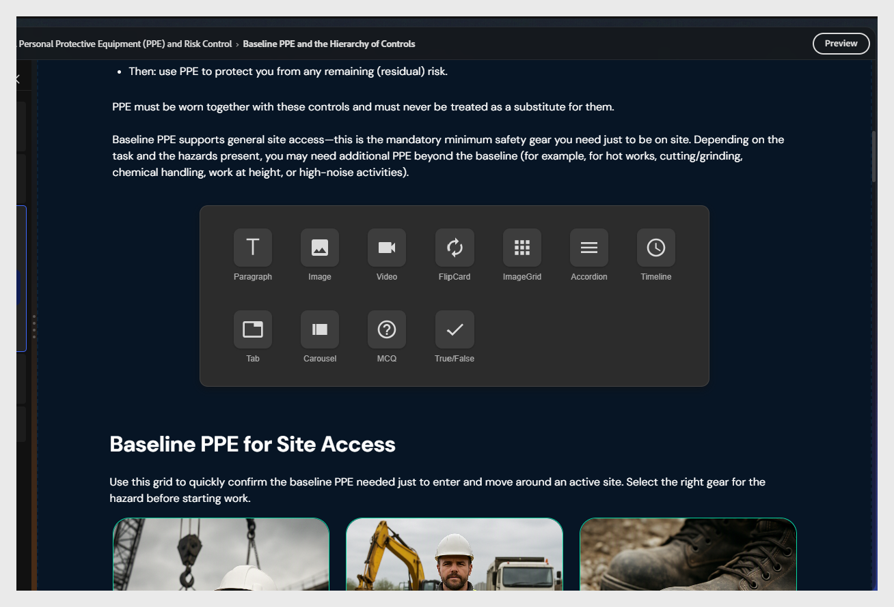
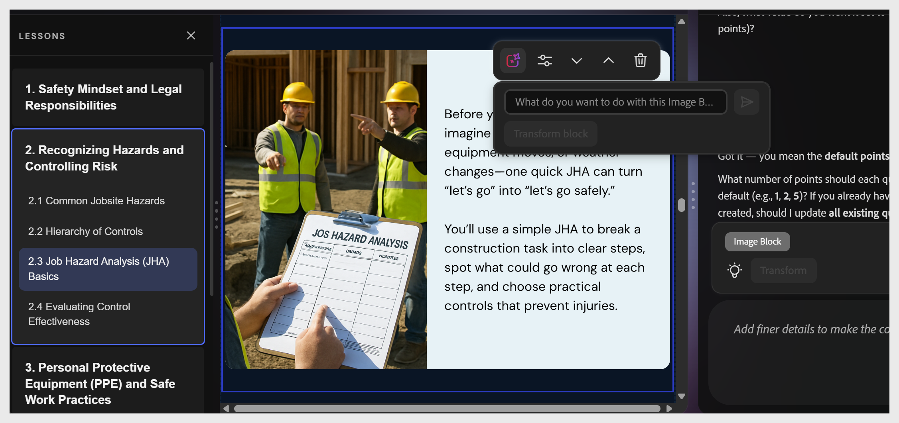

# Aggiungi un componente contenuto

Selezionate tra due elementi esistenti. Viene visualizzato il pulsante +. Selezionalo per aprire il selettore dei componenti.

Componenti disponibili:

<table>
  <thead>
    <tr>
      <th>Componente</th>
      <th>Usa per</th>
    </tr>
  </thead>
  <tbody>
    <tr>
      <td><strong>Paragrafo</strong></td>
      <td>Corpo del testo e spiegazioni</td>
    </tr>
    <tr>
      <td><strong>Immagine</strong></td>
      <td>Illustrazioni, schermate, diagrammi</td>
    </tr>
    <tr>
      <td><strong>Video</strong></td>
      <td>MP4 incorporato o video collegato</td>
    </tr>
    <tr>
      <td><strong>Capovolgi scheda</strong></td>
      <td>Coppie di termini o definizioni, che rivelano le interazioni</td>
    </tr>
    <tr>
      <td><strong>Griglia immagine</strong></td>
      <td>Più immagini in un layout a griglia</td>
    </tr>
    <tr>
      <td><strong>Accordion</strong></td>
      <td>Sezioni espandibili, procedure dettagliate</td>
    </tr>
    <tr>
      <td><strong>Timeline</strong></td>
      <td>Eventi sequenziali o passaggi del processo</td>
    </tr>
    <tr>
      <td><strong>Oggetto Web</strong></td>
      <td>Incorporare contenuto Web esterno, una pagina Web, uno strumento interattivo, un sondaggio o un'applicazione Web, direttamente all'interno di una diapositiva di argomento</td>
    </tr>
    <tr>
      <td><strong>Scheda</strong></td>
      <td>Contenuto parallelo — confronti, varianti regionali</td>
    </tr>
    <tr>
      <td><strong>Carosello</strong></td>
      <td>Serie di immagini o schede di contenuto commutabili</td>
    </tr>
    <tr>
      <td><strong>MCQ</strong></td>
      <td>Controllo delle conoscenze inline senza classificazione</td>
    </tr>
    <tr>
      <td><strong>Vero/Falso</strong></td>
      <td>Controllo vero o falso inline non classificato</td>
    </tr>
  </tbody>
</table>

>[!NOTE]
>
>Utilizza **Accordion** per le procedure dettagliate in cui gli Allievi possono controllare il proprio ritmo. Utilizza **Flip Card** per il contenuto del termine o della definizione.

## Aggiungere un oggetto Web a un corso di Content Composer

Un oggetto Web visualizza contenuto esterno in un fotogramma in linea all’interno del corso. Gli Allievi interagiscono con i contenuti senza uscire dal corso. Utilizzalo per strumenti interattivi, moduli incorporati, sondaggi o qualsiasi risorsa basata sul Web che supporti l’incorporamento di iframe.

### Aggiungi oggetto Web

1. Apri il corso in Composizione contenuti e seleziona l’argomento a cui desideri aggiungere l’oggetto Web.
2. Selezionare due elementi esistenti nella diapositiva argomento. Viene visualizzato il pulsante **+**.
3. Seleziona **+** per aprire il selettore dei componenti.
4. Selezionare **Oggetto Web**. Il blocco viene visualizzato nell&#39;area di lavoro.

### Configurare l&#39;oggetto Web

Selezionare l&#39;icona **Impostazioni** sulla barra degli strumenti blocco oggetto Web per aprire il pannello di configurazione.

### Impostare l&#39;origine di contenuto

In **Contenuto**, seleziona la modalità di caricamento del contenuto esterno:

- **URL**: inserisci l&#39;indirizzo Web della pagina o dello strumento che desideri incorporare. Il contenuto viene caricato all’interno del corso in un fotogramma in linea.
- **Codice di incorporamento**: incolla uno snippet di incorporamento da un servizio di terze parti. Utilizzare questa opzione per gli strumenti che forniscono il proprio codice di incorporamento, ad esempio moduli interattivi, sondaggi o lettori multimediali.
- **Sistema**: seleziona il contenuto da un sistema connesso o da un&#39;integrazione.

### Impostare il height di fotogramma

Nel campo **height di Fotogrammi**, impostare il height del fotogramma di contenuti incorporato in pixel. Utilizza i controlli **+** e **−** per regolare il valore. Il valore predefinito è 498 px.

Regola il height del fotogramma in modo che corrisponda al height naturale del contenuto incorporato. Impostandola su un valore troppo basso viene aggiunta una barra di scorrimento all&#39;interno del fotogramma; impostandola su un valore troppo alto viene aggiunto uno spazio vuoto sotto il contenuto.

### Configurare le opzioni di caricamento e visualizzazione

- **Caricamento automatico**: quando questa opzione è selezionata, il contenuto Web viene caricato automaticamente quando un Allievo raggiunge la diapositiva. Deseleziona questa opzione per le pagine che contengono molto contenuto, per evitare rallentamenti del corso. Quando Caricamento automatico è disattivato, gli allievi selezionano il fotogramma per attivare il caricamento.
- **Blocca titolo** — attiva per visualizzare un&#39;intestazione sopra il blocco di oggetti Web. Utilizza questa opzione per fornire agli Allievi il contesto relativo al contenuto incorporato prima di interagire con esso.

## Spostare i blocchi di contenuto all&#39;interno di un argomento

Potete riordinare i blocchi di contenuto all&#39;interno di un argomento utilizzando le opzioni di modifica nella barra degli strumenti o l&#39;intelligenza artificiale.

