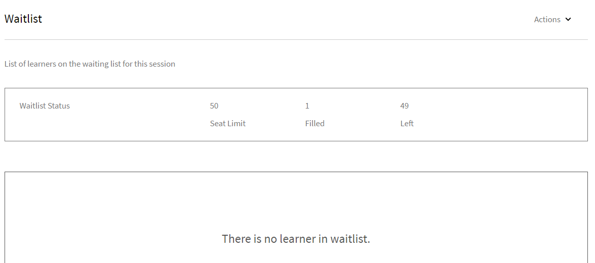
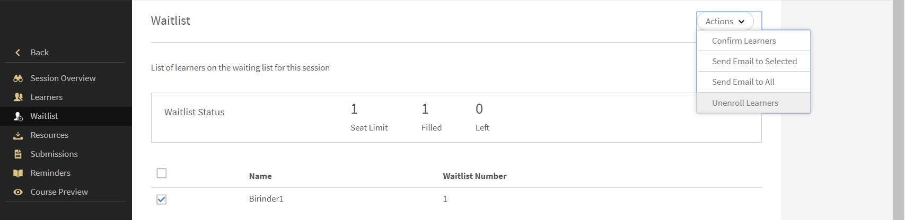
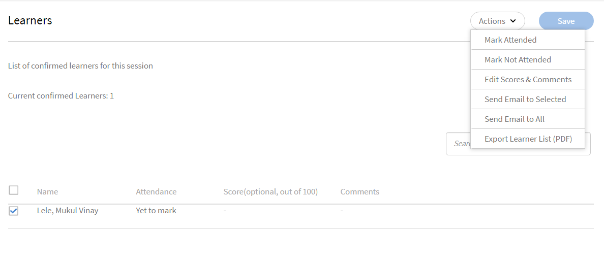
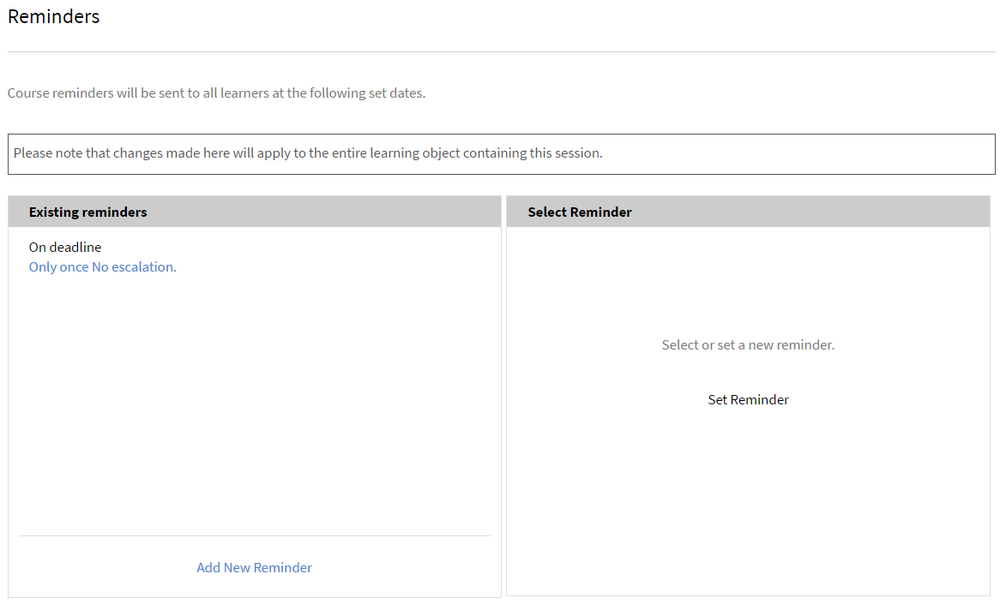
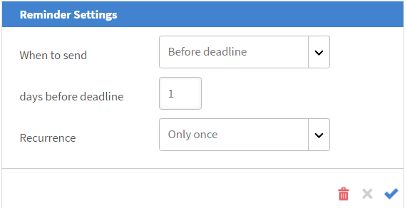
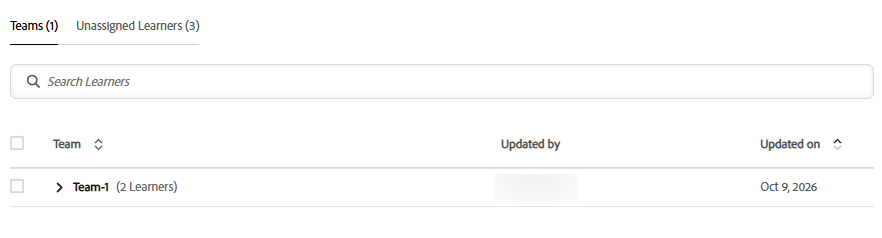
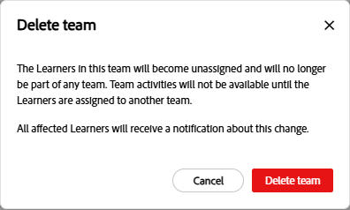

# Gestione degli Allievi per la sessione

Leggi questo articolo per scoprire come gestire i partecipanti, inviare e-mail relative al corso e promemoria delle sessioni.

## Visualizzazione di sessioni o moduli con revisioni in sospeso {#pending}

In qualità di istruttore, puoi vedere le sessioni o i moduli con revisioni in sospeso.

Nella pagina delle sessioni/dei moduli, è disponibile la colonna **Revisioni in sospeso** che mostra il numero di revisioni in sospeso per il corso/l’attività corrispondente.

## Gestione della lista d’attesa per la sessione {#managewaitlistforyoursession}

Quando gli Allievi si registrano al modulo, puoi visualizzare lo stato più recente della registrazione e della lista d’attesa dalla pagina Lista d’attesa.

1. Dall’applicazione dell’Istruttore, seleziona Sessioni pianificate > Lista d’attesa nel riquadro di navigazione a sinistra.

   Puoi visualizzare il limite di posti, il numero di posti attualmente occupati e quello dei posti vacanti. In una tabella sono inoltre elencati gli Allievi inseriti in lista d’attesa. Il campo è vuoto se non vi sono code di lista d’attesa.

   
   *Visualizza Allievi in lista d’attesa*

1. Nella tabella Lista d’attesa, seleziona l’Allievo o gli Allievi da confermare.
1. Seleziona Azioni > Conferma Allievi.

   Gli Allievi confermati sono aggiunti all’elenco di Allievi confermati.

Gli istruttori hanno la possibilità di annullare l’iscrizione degli Allievi alle sessioni. In questo modo viene annullata l’iscrizione dagli apprendimenti corrispondenti. Seleziona la scheda **[!UICONTROL Lista d’attesa]**. Seleziona gli Allievi di cui annullare l’iscrizione tramite la casella di controllo. Per annullare l’iscrizione, seleziona **[!UICONTROL Azioni]** > **[!UICONTROL Annulla iscrizione allievi]**.

*Annulla l’iscrizione degli Allievi*

### Report lista d’attesa

Il nuovo **[!UICONTROL Report della lista d’attesa]** di Adobe Learning Manager consente agli istruttori di scaricare l’elenco degli allievi in lista d’attesa per tutte le istanze di un corso. Gli istruttori possono accedere a questo report dalla sezione **[!UICONTROL Lista d’attesa]** nella pagina **[!UICONTROL Panoramica della sessione]**.

Seguire le colonne disponibili nel report Lista d&#39;attesa:

* Nome del corso
* Nome dell’istanza
* ID istanza
* Stato istanza
* Nome utente
* E-mail
* ID univoco utente
* Data di iscrizione (fuso orario UTC)
* Stato
* Numero di lista d’attesa
* Limite per la lista d’attesa
* Posti limitati

Per scaricare il report dalla sezione Istruttore:

1. Accedi come **[!UICONTROL Istruttore]**.
2. Seleziona una sessione dalla home page.
3. Selezionare l&#39;opzione **[!UICONTROL Lista d&#39;attesa]** nella pagina **[!UICONTROL Panoramica della sessione]**.
4. Seleziona **[!UICONTROL Azioni]** > **[!UICONTROL Esporta report]** per scaricare il report **[!UICONTROL In lista d’attesa]**.

## Partecipazione alla sessione {#markattendanceforyoursession}

Puoi visualizzare il numero di Allievi confermati che stanno partecipando alla sessione, i nomi, lo stato di partecipazione degli Allievi e altri dettagli dalla pagina Allievi.

1. Nel riquadro di navigazione a sinistra, fai clic su Sessioni pianificate > Allievi.
1. Seleziona gli Allievi dall’elenco di partecipanti ed effettua quanto segue:

   * Per contrassegnare la partecipazione, fai clic su Azioni > Contrassegna partecipazione. Quando lo stato viene modificato per confermare la partecipazione, non puoi modificarlo.
   * Per contrassegnare la mancata partecipazione, fai clic su Azioni > Partecipazione non avvenuta.
   * Per eliminare un Allievo a causa dell’annullamento o per altri motivi, fai clic su Azioni > Elimina Allievi.

   Un Allievo non può completare un modulo fino a quando lo stato di partecipazione non è confermato.

   
   *Contrassegna partecipazione Allievo*

### Scaricare i codici QR per l’iscrizione e la partecipazione degli Allievi

Gli istruttori possono scaricare i codici QR per le sessioni assegnate, per consentire agli Allievi di iscriversi a un’istanza del corso e contrassegnare la partecipazione o il completamento scansionando il codice QR.

Ciò consente agli istruttori di gestire la partecipazione alla sessione in modo indipendente, senza richiedere l’assistenza dell’amministratore.

I seguenti passaggi sono adatti a entrambi:

* Sessioni in aula fisica
* Sessioni online in aula

Per una sessione fisica in aula, in qualità di Istruttore, devi generare il codice QR corretto e incollarlo nella classe (o farlo circolare) in cui gli Allievi partecipano alla sessione, in modo che possano scansionare il codice QR e contrassegnare la loro iscrizione o partecipazione o entrambi a seconda del codice QR.

In qualità di Istruttore, per una sessione in aula online puoi inviare il codice QR generato tramite posta, un sistema di messaggistica o qualsiasi altro mezzo, in modo che gli Allievi possano scansionare il codice QR e contrassegnare la propria iscrizione o partecipazione o entrambi, a seconda del codice QR.

#### Scaricare i codici QR per una sessione

1. Accedi a Adobe Learning Manager con il ruolo **Istruttore**.
2. Passa alla **Dashboard Istruttore**.
3. Apri l&#39;**istanza del corso** pertinente.
4. Selezionare la scheda **Sessioni**.
5. Scegli una sessione a te assegnata.
6. Seleziona **Codice QR sessione**.
   

Puoi scaricare i seguenti codici QR:

* **Codice QR di iscrizione**: consente agli Allievi di iscriversi all’istanza del corso
* **Codice QR di partecipazione**: indica la partecipazione alla sessione
* **Codice QR iscrizione e partecipazione** - iscrive gli Allievi e contrassegna la partecipazione in un’unica scansione

Il codice QR viene scaricato come PDF e può essere condiviso digitalmente o visualizzato durante la sessione.

#### Cosa succede quando gli Allievi acquisiscono il codice QR

* Gli Allievi acquisiscono il codice QR tramite un dispositivo mobile.
* Adobe Learning Manager convalida l’Allievo e la sessione.
* In base al tipo di codice QR:
  * Gli Allievi sono iscritti all’istanza del corso oppure
  * La partecipazione e il completamento vengono registrati per la sessione

Tutti gli aggiornamenti vengono riportati automaticamente nei record, nelle trascrizioni e nei report degli Allievi.

#### Note

* I codici QR sono disponibili solo per gli istruttori assegnati alla sessione.
* Le regole di iscrizione, partecipazione e completamento configurate per il corso e la sessione continuano ad applicarsi.
* I flussi di lavoro esistenti relativi all’avanzamento degli Allievi e alla creazione di report rimangono invariati.

#### Casi d’uso

* Le organizzazioni che eseguono grandi volumi di sessioni in loco (ad esempio, formazione sul prodotto per professionisti) possono consentire agli istruttori di stampare codici QR specifici per sessione che registrano e contrassegnano la partecipazione con una scansione.

* Nei corsi di formazione per la vendita al dettaglio, la produzione industriale e l’assistenza sanitaria, in cui gli Allievi spesso partecipano alle sessioni direttamente dal pavimento o senza pre-iscrizione, è possibile inserire un codice QR &quot;Iscrizione + Partecipazione&quot; sulla porta. Ciò consente agli Allievi di provvedere autonomamente all’iscrizione e alla partecipazione tramite telefono.

* Gli eventi di formazione per partner o clienti consentono al formatore on-site di adattarsi facilmente alle modifiche della stanza, a sessioni aggiuntive o a partecipanti aggiuntivi senza dover consultare l&#39;amministratore per nuovi codici QR.

### Inviti del calendario {#calendarinvites}

* Quando un Allievo o un Istruttore è iscritto a una sessione di un’aula o di un’aula virtuale, Learning Manager invia un invito nel calendario (file ICS).
* L&#39;invito del calendario include:

  * Data e ora della sessione
  * Dettagli della sessione
  * **Collegamento diretto alla sessione** nella descrizione del calendario

  

I partecipanti possono aprire l&#39;evento del calendario e partecipare alla sessione direttamente dal proprio calendario.

#### Partecipazione a una sessione da Gmail

1. Apri **Calendario di Google**.
2. Selezionare l&#39;evento sessione.
3. Nei dettagli dell&#39;evento, fare clic sul collegamento **session join**.
4. La sessione si apre direttamente in Adobe Learning Manager o nello strumento per aula virtuale configurato.

Non è necessario aprire l’e-mail originale per accedere al collegamento della sessione.

#### Partecipazione a una sessione da altri client del calendario

Il collegamento della sessione è incluso nel corpo dell&#39;evento del calendario ed è accessibile da:

* Microsoft Outlook
* Calendario di Apple
* Altre applicazioni di calendario che supportano file ICS

#### Note

* Gli inviti al calendario vengono generati automaticamente da Learning Manager.
* Le informazioni sul fuso orario nell’invito del calendario vengono adattate in base al fuso orario selezionato dell’Allievo.
* Questo miglioramento si applica agli inviti del calendario appena generati.
* Gli amministratori e gli istruttori non richiedono alcuna configurazione aggiuntiva.

## Contrassegna come completato gli Allievi

Gli istruttori possono contrassegnare lo stato di successo di ciascun Allievo come Superato o Non riuscito direttamente dalla pagina Allievi. Questa funzione consente agli istruttori di registrare con precisione il risultato di sessioni in aula o in aula virtuale in base alle prestazioni dell’Allievo.

Per contrassegnare il successo per gli Allievi:

1. Accedi a Adobe Learning Manager come Istruttore.
2. Seleziona **[!UICONTROL Sessioni pianificate]** nel riquadro di navigazione a sinistra.
3. Seleziona **[!UICONTROL Allievi]**.
4. Seleziona gli Allievi, quindi seleziona **[!UICONTROL Azioni]**.
5. Seleziona una delle opzioni seguenti per segnalare l’esito positivo per gli Allievi selezionati:

   * **[!UICONTROL Contrassegna come partecipante e superato]**: gli allievi contrassegnati come superato hanno completato correttamente il modulo.
   * **[!UICONTROL Contrassegna come Partecipato/Non riuscito]**: gli Allievi contrassegnati come Non riuscito hanno completato il modulo ma non lo hanno superato.

   
   _Pagina Allievi che mostra il menu Azioni con le opzioni Contrassegna come partecipato e Contrassegna come partecipato e Non riuscito evidenziate per la registrazione dei risultati degli Allievi_

6. Seleziona **[!UICONTROL Sì]** nella richiesta di conferma.

## Invio di e-mail agli Allievi {#sendemailstolearners}

Puoi inviare e-mail a tutti o a uno specifico partecipante per la sessione. La funzionalità di invio e-mail è molto utile se desideri confermare la partecipazione degli Allievi o se desideri inviare comunicazioni relative alla sessione. Puoi inoltre utilizzare l’opzione di invio a tutti tramite e-mail per inviare l’assegnazione e il materiale della sessione o comunicazioni generali a tutti gli Allievi.

Per inviare e-mail agli Allievi, nella pagina Allievi dell’applicazione Istruttore effettua quanto segue:

* Per inviare e-mail a partecipanti specifici, seleziona il partecipante e fai clic su Azioni > Invia e-mail a soggetti selezionati.
* Per inviare a tutti i partecipanti e-mail contenenti il materiale del corso o un’assegnazione, fai clic su Azioni > Invia e-mail a tutti.

## Acquisire le risposte di invito

Gli istruttori possono acquisire le risposte agli inviti degli Allievi solo quando l’opzione **[!UICONTROL Rispondi agli inviti]** è abilitata dall’amministratore ACAP. Per abilitare questa funzione, gli amministratori devono contattare il team di supporto all&#39;indirizzo [learningmanagersupport@adobe.com](mailto:learningmanagersupport@adobe.com).

Al termine, puoi visualizzare le risposte all’invito nella sezione **[!UICONTROL Allievi]**. Accedi a una sessione, seleziona **[!UICONTROL Allievi]** e seleziona la risposta all’invito dal menu a discesa.

## Esportazione dell’elenco di Allievi {#exportinglearnerslist}

In qualità di istruttore, puoi contrassegnare facilmente la partecipazione per tutti gli studenti esportando l’elenco dei partecipanti come pdf. Per esportare l’elenco dei partecipanti, dall’Allievo dal riquadro sinistro: fai clic su Azioni > Esporta elenco utenti (PDF).

Dopo che l’elenco dei partecipanti è stato confermato per la sessione, puoi esportarlo come PDF. Questo PDF facilmente stampabile visualizza gli Allievi in una tabella. Puoi quindi contrassegnare la partecipazione o fornire punteggi, nonché creare o fornire note per gli studenti, tutto nello stesso PDF.

Un codice QR è presente nell’angolo superiore destro del PDF. Questa funzionalità consente ai singoli Allievi di scansionare il codice utilizzando l’app mobile Learning Manager per contrassegnare la propria partecipazione.

*Scansiona il codice QR per contrassegnare la partecipazione*

## Approvazione o rifiuto di invii {#approveorrejectsubmissions}

Se gli Allievi hanno caricato documenti come assegnazioni, report o valutazioni per la sessione, puoi visualizzare i documenti nella pagina degli invii. Puoi utilizzare i materiali per la classificazione dell’Allievo e approvare o rifiutare l’invio.

1. Nel riquadro a sinistra, fai clic su Sessioni pianificate o Sessioni passate, in base alla pianificazione della sessione.
1. Fai clic sul corso per il quale desideri visualizzare gli invii.

   Nel riquadro a sinistra, fai clic sull’opzione di invio.

1. Puoi visualizzare gli invii dagli Allievi per la sessione selezionata. Seleziona l’invio da approvare o rifiutare e fai clic su Approva o Rifiuta.

   Lo stato dell’invio viene modificato in approvato o rifiutato, in base all’azione.

## Configurazione di promemoria per la sessione {#configureremindersforyoursession}

1. Nel riquadro a sinistra, fai clic su Sessioni pianificate.
1. Fai clic sul corso per il quale impostare il promemoria. Nel riquadro a sinistra, fai clic su Promemoria.
1. Nella sezione Seleziona promemoria, fai clic su Imposta promemoria.

   
   *Configurare i promemoria per la sessione*

1. Effettuate una delle seguenti operazioni:

   * Nella finestra di dialogo di impostazioni del promemoria, imposta l’opzione di invio del promemoria agli Allievi: Prima della scadenza, Alla scadenza o Dopo la scadenza.
   * Nel campo relativo ai giorni prima della scadenza, imposta il numero di giorni rimanenti alla scadenza in cui desideri inviare il promemoria agli Allievi.
   * Imposta la ricorrenza per il promemoria.

   
   *Visualizza impostazioni promemoria*

1. Effettua una delle seguenti operazioni:

   * Fai clic sul segno di spunta per salvare il promemoria.
   * Fai clic sulla croce per annullare il promemoria.

   Un promemoria automatico del corso viene inviato a tutti gli Allievi alla data indicata nelle impostazioni del promemoria.

   Se hai già impostato promemoria per le sessioni, puoi visualizzarli nelle sezioni relative ai promemoria esistenti. Inoltre, puoi aggiungere ulteriori promemoria ai promemoria esistenti.

   Per eliminare un promemoria esistente, selezionalo. Nella finestra a comparsa visualizzata, fai clic sull’icona di eliminazione (icona del cestino) per eliminare il promemoria.

## Creazione e gestione dei team in Adobe Learning Manager

Crea i team manualmente dagli Allievi in un’istanza del corso, quindi aggiungi, sposta, rimuovi, rinomina o elimina i team fino a quando un team non si blocca.

In qualità di Istruttore, puoi creare team per ogni istanza di un corso che dispone di un modulo di invio basato su team. Qualsiasi istruttore assegnato all’istanza può gestire i propri team. Adobe Learning Manager può anche creare i team automaticamente. Una volta formati i team, gli allievi possono inviare il lavoro ed è possibile valutare gli invii dei team.

### Apri la pagina di gestione di Teams

1. Nell’app dell’Istruttore, seleziona **Teams** nel riquadro di navigazione a sinistra. Nella pagina sono elencate le istanze del corso basate sul team a cui sono assegnati gli allievi.

   

1. Per trovare un corso, cercalo oppure ordina l’elenco in base alla data dell’ultimo aggiornamento.

1. Seleziona l’istanza del corso. La pagina dell’istanza mostra gli Allievi non assegnati e i team.

### Creare team con una regola

1. Nella pagina dell’istanza, seleziona gli Allievi non assegnati da dividere in team.

1. Scegli una regola. Seleziona **Azione** > **Crea un singolo team** o **Crea più team**.

   

1. Se selezioni **Più team**, immetti il numero di Allievi per ogni team. Il valore deve essere maggiore o uguale a 1. La pagina mostra il numero di team che verranno creati. Ad esempio, con 94 Allievi e 2 Allievi per team, vengono creati 47 team. Se il numero è maggiore del numero di allievi iscritti, viene visualizzato un messaggio di errore. Immettete un numero più piccolo.

   

   Se immetti un valore maggiore del numero di Allievi iscritti, viene visualizzato un messaggio di errore.

   

1. Seleziona **Crea team**. I team vengono visualizzati nella scheda **Team**.

   

1. Conferma e salva. I team vengono visualizzati nella scheda **Team**.

La regola si applica solo agli Allievi non assegnati selezionati. Per raggruppare tutti, elimina prima i team esistenti. I loro Allievi tornano all’elenco dei non assegnati.

Dopo aver selezionato **Elimina**, viene visualizzata la seguente finestra di dialogo di conferma:

Seleziona **Elimina team**. Tutti gli Allievi tornano all’elenco dei non assegnati.

### Crea un singolo team

1. Seleziona gli Allievi non assegnati da includere nel team.

1. Seleziona **Azione** > **Crea un singolo team**. Viene creato un team con il numero specificato di Allievi.

   

1. Salva il team. Un team richiede almeno un Allievo e un Allievo può appartenere a un solo team nell’istanza.

1. Ripeti i passaggi per creare i team uno alla volta.

### Aggiungere Allievi a un team esistente

1. Seleziona gli Allievi non assegnati da aggiungere.

1. Scegli di assegnarli a un team esistente, quindi seleziona il team.

   

1. Conferma la tua scelta. Seleziona **Assegna Allievo**.

### Spostare o rimuovere gli Allievi

1. Apri la scheda **Team**, quindi espandi un team per visualizzarne i membri.

1. Seleziona gli Allievi da spostare.

   

1. Scegli per spostarli, quindi seleziona il team di destinazione.

1. Per rimuovere un Allievo da un team, selezionalo e rimuovilo. L’Allievo ritorna all’elenco dei non assegnati.

Quando un team non ha allievi rimanenti, il team viene eliminato automaticamente.

### Rinominare un team

1. Nella scheda **Team**, seleziona il team, quindi scegli di rinominarlo.

1. Selezionare **Azione** > **Rinomina**.

   

1. Immetti un nome univoco, ad esempio Alpha team.

   

1. Seleziona **Rinomina team**.

I nomi non possono essere ripetuti e non puoi utilizzare il formato generato dal sistema, ad esempio Team-1.

### Elimina team

1. Nella scheda **Team**, seleziona uno o più team.

1. Selezionare **Azione** > **Elimina**.

1. Seleziona **Elimina team**.

   

1. Conferma. Gli Allievi dei team eliminati tornano all’elenco dei non assegnati.

### Gestire le iscrizioni in ritardo e le iscrizioni annullate

* Un Allievo che si iscrive dopo aver formato i team viene visualizzato nell’elenco non assegnato. Aggiungi l’Allievo a un team.
* Se tutti i team sono bloccati, crea un nuovo team per l’Allievo.
* Un Allievo che annulla l’iscrizione viene rimosso automaticamente dal team. Il team continua e viene eliminato un team vuoto.

### Risoluzione dei problemi

**Non puoi selezionare un team o spostarne i membri.** Un team si blocca dopo il primo invio e il blocco si applica a ogni modulo team nell’istanza. Per sbloccare il team, annulla l&#39;invio. Visualizza **Valuta e annulla l&#39;invio di invii di team**.

**Impossibile rinominare un team.** Il nome è già in uso o corrisponde al formato generato dal sistema. Immetti un nome diverso.

**Viene visualizzato un errore durante la creazione dei team.** Un team non può avere più di 100 membri. Riduci il numero di membri per team.

**Non puoi aprire Gestione team per un&#39;istanza.** È possibile che la creazione automatica del team sia in esecuzione. Al termine dell&#39;operazione verrà restituito Access.

**Il salvataggio è stato rifiutato e la pagina viene ricaricata.** Un altro istruttore o il lavoro automatico salvato cambia prima. Verifica i team aggiornati, quindi ripristina le modifiche.

**Un team è scomparso.** Un team senza allievi viene eliminato automaticamente.

## Valutare e annullare l&#39;invio degli invii del team

Rivedere il file inviato di un team, completare il piano di valutazione, approvare o rifiutare il lavoro o annullarne l&#39;invio in modo che il team possa inviarlo nuovamente.

Quando si valuta l&#39;invio di un team, il risultato si applica a ogni membro del team e ogni membro riceve una notifica. Solo gli istruttori assegnati all’istanza possono valutarla. I passaggi sono gli stessi per i singoli invii, a eccezione del fatto che i singoli invii non hanno dettagli sul team. Assicurati che i team esistano per primi. Visualizza **Crea e gestisci team**.

I team creati automaticamente possono essere modificati come i team manuali.

### Trovare un inoltro

1. Nell&#39;app dell&#39;Istruttore, apri l&#39;area degli invii, quindi seleziona **Invii team**. Seleziona **Invii singoli** per i moduli per singolo Allievo.

1. Per trovare un modulo, cerca per nome di sessione o modulo.

1. Seleziona il nome del modulo.

   

1. Per restringere l&#39;elenco, filtrare in base allo stato: **Invio in sospeso**, **Revisione in sospeso**, **Approvato**, **Rifiutato** o **Completato**.

1. Per visualizzare i membri del team, espandere il team. Vengono visualizzati i nomi e gli indirizzi e-mail e l’Allievo che ha inviato il file ha un tag **Mittente**.

1. Per scaricare il file inviato, seleziona l’opzione di download per il team.

### Valutare un inoltro

1. Trova il team con lo stato **Revisione in sospeso**.

1. Apri il file inviato ed esamina il contenuto.

1. Selezionare **Azione** > **Valuta**.

   

1. Completare il piano di valutazione:

   * Rispondi a ogni domanda richiesta.
   * Per domande oggettive, selezionare un&#39;opzione. Con il punteggio basato su criteri, il punteggio viene aggiornato man mano che si seleziona.
   * Per domande soggettive, inserisci la tua risposta.
   * Se sono consentite osservazioni, aggiungere osservazioni alla domanda o all&#39;intera valutazione.

   

1. Se il modulo richiede l&#39;approvazione del revisore, selezionare **Approva** o **Rifiuta**. Aggiungi un commento quando rifiuti, in modo che il team sappia cosa correggere.

   

1. Se il modulo utilizza lo scoring manuale, inserire il punteggio complessivo.

   

   **Facoltativo**: immettere una nota privata selezionando l&#39;interruttore **Aggiungi una nota privata al punteggio**. Una nota privata è visibile solo agli istruttori assegnati all’istanza. Gli Allievi non possono visualizzarlo, nemmeno quando selezioni **Mostra commento**.

1. Presentare la valutazione. Seleziona **Invia**. Lo stato dell&#39;invio cambia in **Approvato**.

   

Anche altri istruttori possono valutare lo stesso invio, a condizione che non sia già stato approvato. Una valutazione successiva sostituisce una precedente fino all&#39;approvazione della presentazione.

Se il modulo non richiede l&#39;approvazione del revisore, il modulo viene completato per tutti i membri del team al momento dell&#39;invio. Viene visualizzata solo l&#39;opzione di invio e non è possibile modificare il punteggio o le note in seguito.

Dopo aver approvato o rifiutato l’invio di un team, un Allievo può visualizzare lo stato dell’invio e il risultato della valutazione.

Selezionando il risultato della valutazione vengono visualizzati i parametri di valutazione e i commenti dell’istruttore.

## Rivedere o modificare una valutazione

1. Trovare un team con lo stato **Rifiutato**.

1. Per aprire la valutazione completata, selezionare **Visualizza valutazione**.

1. Per eseguire nuovamente la valutazione, selezionare l&#39;opzione di rivalutazione e inviare le modifiche. Questa operazione può essere eseguita solo per gli invii rifiutati. **Impossibile modificare gli invii approvati**.

### Annulla invio di un inoltro

Annullare l&#39;invio quando il team deve inviarlo di nuovo, quando la valutazione deve ricominciare o quando è necessario modificare un team bloccato. Per un singolo inoltro, puoi anche utilizzarlo per correggere una valutazione inserita per l’Allievo errato.

1. Trova un team o un Allievo che ha un invio.

1. Seleziona **Annulla invio**.

   

1. Immetti i tuoi commenti, quindi seleziona **Annulla invio**.

   

L&#39;invio è stato rimosso e lo stato torna a **Invio in sospeso**. Il team si sblocca, in modo che sia possibile modificarne i membri. I membri del gruppo ricevono una notifica e un&#39;e-mail. Qualsiasi membro può quindi inviare di nuovo e il nuovo file sostituisce quello precedente. La nuova valutazione sostituisce quella precedente e non viene conservata alcuna cronologia.

Non puoi annullare l’invio dopo che il corso è stato completato per un membro del team, perché il completamento non può essere annullato.