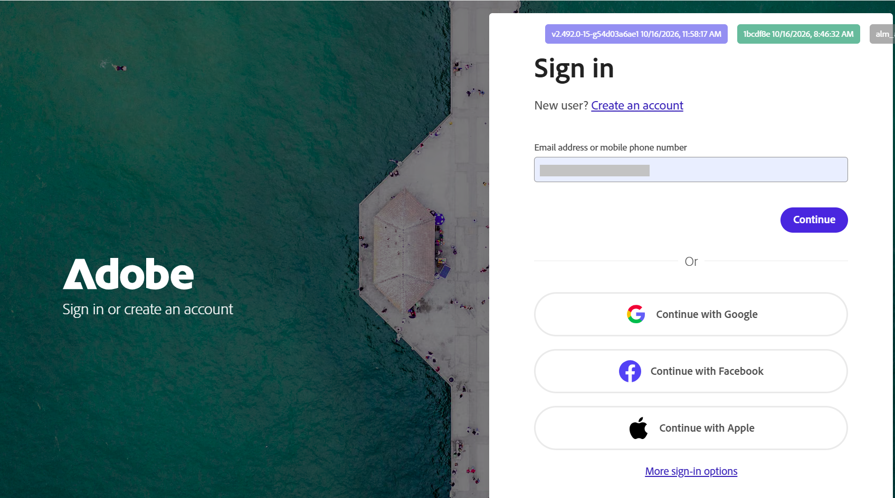
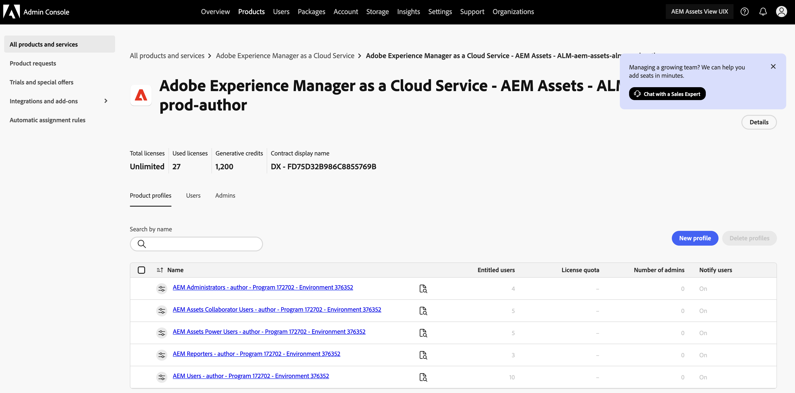
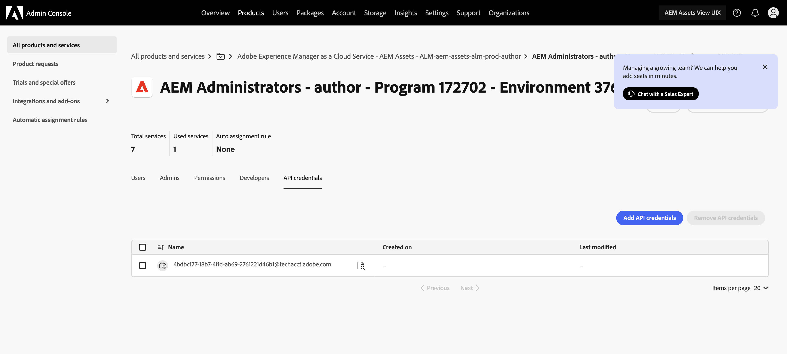
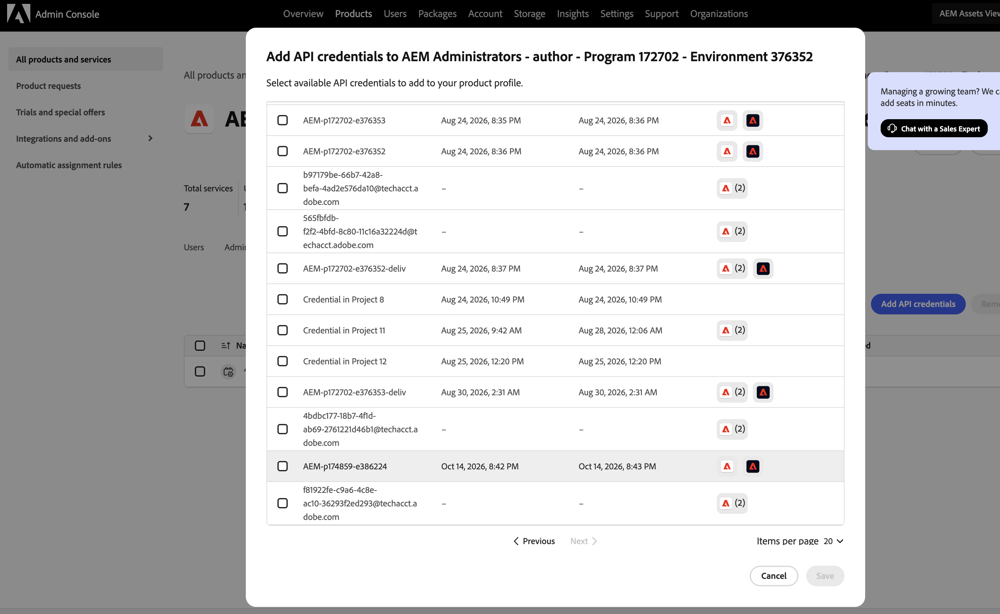

# Integrazione delle risorse AEM

## Panoramica

Adobe Learning Manager ora si integra con Adobe Experience Manager Assets as a Cloud Service. I team possono archiviare immagini e contenuti di apprendimento in Adobe Experience Manager Assets, importarli in Adobe Learning Manager e gestire gli aggiornamenti da un&#39;unica posizione. Quando una risorsa cambia, il contenuto collegato nella Libreria dei contenuti può essere aggiornato automaticamente, quindi gli Autori non devono ricaricare i file.

Poiché la tua organizzazione gestisce le risorse in un unico luogo, gli Autori utilizzano i file correnti approvati dal marchio invece di scaricare e ricaricare le copie. Adobe Experience Manager Assets conserva inoltre la cronologia delle versioni di ciascun file, con la quale viene registrato quale versione era attiva e quando.

L&#39;impostazione è un&#39;operazione da eseguire una sola volta ed è la parte che richiede maggiore attenzione. Dopo la configurazione, l&#39;importazione delle risorse funziona come qualsiasi altro caricamento.

>[!NOTE]
>
>Questa integrazione è disponibile per tutti gli account Adobe Learning Manager con una licenza Adobe Experience Manager Assets, inclusi gli account Prime e Ultimate. La stessa documentazione si applica a entrambi.

## Chi fa cosa

| Ruolo | Cosa fanno |
|---|---|
| Amministratore integrazione ALM | Collega l’account e sceglie le impostazioni di integrazione. |
| Amministratore Adobe Admin Console | Assegna l’account tecnico generato ai profili di prodotto AEM Assets corretti. |
| Amministratore ALM | Importa immagini da varie posizioni mediante l’integrazione. |
| Autore ALM | Importa contenuti e immagini e crea corsi. |

Ogni ruolo ha una parte separata nell&#39;impostazione e nell&#39;utilizzo dell&#39;integrazione.

## Distribuzioni supportate

| Elemento | Supportato |
|---|---|
| Adobe Experience Manager Assets as a Cloud Service, istanza dell&#39;autore | Sì |
| Istanza di pubblicazione o consegna di Adobe Experience Manager Assets as a Cloud Service | No |
| Adobe Experience Manager locale | No |

>[!NOTE]
>
>Adobe Learning Manager si connette alle istanze degli autori solo perché le risorse vengono create e gestite lì. Publish e le istanze di distribuzione non fanno parte dell&#39;integrazione corrente.

## Configurare l’integrazione

Collega Adobe Learning Manager ad Adobe Experience Manager Assets, assegna l&#39;account tecnico e scegli le impostazioni di aggiornamento.

Questo flusso di lavoro è per gli Amministratori di integrazione. Completa ogni passaggio in modo che gli aggiornamenti automatici funzionino per i tuoi Autori. La configurazione è composta da cinque parti: connettiti alla tua organizzazione IMS, trova l&#39;account tecnico, assegnalo in Adobe Admin Console, scegli le tue impostazioni e concedi l&#39;accesso agli Autori.

### Prerequisiti {#setup-prerequisites}

Devi soddisfare tutti questi requisiti. La mancanza di uno di questi è il motivo più comune per cui una connessione non riesce.

* In Adobe Learning Manager hai il ruolo Amministratore di integrazione. Il flusso di lavoro di connessione è disponibile solo per questo ruolo.
* Sei un amministratore dell&#39;organizzazione IMS per l&#39;organizzazione Identity Management System (IMS) selezionata.
* Hai accesso ad almeno un’organizzazione in cui le istanze di AEM Assets possono essere associate a Learning Manager.

Se non sei un amministratore dell&#39;organizzazione IMS, chiedi al tuo amministratore IT di concederti l&#39;accesso o di eseguire la connessione con te.

### Mapping di Adobe Learning Manager con l&#39;organizzazione IMS

Ogni account Adobe Learning Manager si connette a un&#39;organizzazione IMS (denominata anche profilo IMS). Quando pianifichi la configurazione, tieni presente quanto segue:

* Un&#39;organizzazione IMS può contenere diversi programmi e ambienti e ogni programma può avere istanze Adobe Experience Manager Assets. Puoi utilizzare una di queste istanze con l&#39;account connesso.
* Le istanze in un&#39;organizzazione IMS diversa non possono essere utilizzate con quell&#39;account.
* Un&#39;organizzazione IMS collegata a un account Adobe Learning Manager non può essere collegata a un altro account contemporaneamente.

>[!NOTE]
>
>Se la tua azienda dispone di più di un&#39;organizzazione IMS, scegli quella che detiene la tua licenza Adobe Experience Manager Assets e le istanze che desideri vengano utilizzate dagli Autori.

### Connessione all&#39;organizzazione IMS

1. Accedi a Adobe Learning Manager come **Amministratore di integrazione**.
1. Seleziona **Adobe Experience Manager Assets** come tipo di connettore.

   

1. Seleziona **Connetti**.

   

1. Quando richiesto, accedi con il tuo Adobe ID e seleziona l&#39;organizzazione IMS che contiene le tue istanze di Adobe Experience Manager Assets.

   

   

Adobe Learning Manager verifica quindi il ruolo di amministratore dell&#39;organizzazione IMS e l&#39;accesso all&#39;istanza. Se entrambi i controlli passano, il tuo account viene collegato all&#39;account IMS già creato con ambito API Autore AEM Assets all&#39;organizzazione IMS selezionata e viene creato un account tecnico per la tua organizzazione. Viene visualizzata la pagina con la panoramica della connessione, contenente i dettagli tecnici dell&#39;account.

### Trovare l&#39;account tecnico

L&#39;account tecnico è stato creato appositamente per la tua organizzazione. Adobe Learning Manager lo utilizza per leggere o scrivere in background utilizzando l&#39;[API aperta](https://developer.adobe.com/experience-cloud/experience-manager-apis/api/experimental/assets/author/) di AEM Assets.

1. Accedi come **Amministratore dell’integrazione**, apri la pagina della panoramica della connessione di **Adobe Experience Manager Assets**.
1. Nella sezione **Credenziali**, individua l&#39;**e-mail dell&#39;account tecnico**.
1. Copia l&#39;e-mail dell&#39;account tecnico. Verrà utilizzato per trovare l&#39;account in **Adobe Admin Console**.

### Assegnare l&#39;account tecnico in Adobe Admin Console

Aggiungi l&#39;account tecnico a un profilo di prodotto per ogni istanza di Adobe Experience Manager Assets che desideri che Adobe Learning Manager utilizzi. Se, ad esempio, disponi di 10 istanze e desideri che solo 6 di esse funzionino con Adobe Learning Manager, assegna l’account ai profili delle 6 istanze.

1. Accedi a **Adobe Admin Console** come amministratore della stessa organizzazione IMS.
2. Seleziona **Prodotti e servizi**, quindi seleziona **Adobe Experience Manager as a Cloud Service**.

   

3. Selezionate l’istanza da usare con Adobe Learning Manager.

   

4. Apri il profilo di prodotto con l&#39;accesso necessario per Adobe Learning Manager. Ad esempio, il profilo Amministratori AEM.

   

5. Selezionare **Aggiungi credenziali API**.

   

6. Cerca l&#39;account tecnico. Deve corrispondere all’indirizzo e-mail dell’account tecnico copiato dall’Amministratore di integrazione. L’account si trova in genere nella parte inferiore dell’elenco.

   

7. Seleziona l&#39;account tecnico, quindi seleziona **Salva**.
8. Ripetere i passaggi da 3 a 7 per ogni istanza che si desidera utilizzare.

Se l’elenco delle credenziali API del profilo è vuoto, l’account tecnico non è ancora stato assegnato. Per ulteriori informazioni sui profili di prodotto e sulle credenziali API, consulta la documentazione Adobe Admin Console.

>[!IMPORTANT]
>
>Non salti questo passaggio. Se non assegni l&#39;account tecnico, gli Autori possono comunque importare risorse da Adobe Experience Manager Assets, ma gli aggiornamenti automatici non funzionano. È quindi necessario aggiornare manualmente il contenuto.

### Scegliere le impostazioni di integrazione

Dopo la connessione, attiva la connessione e scegli in che modo Adobe Learning Manager gestisce gli aggiornamenti e le anteprime.

| Impostazione | Che cosa fa |
|---|---|
| Aggiornamenti automatici | Aggiorna gli elementi della Libreria dei contenuti collegati quando la risorsa cambia in Adobe Experience Manager Assets. |
| Aggiornamento degli oggetti di apprendimento | Applica inoltre l’aggiornamento agli oggetti di apprendimento che utilizzano l’elemento Libreria dei contenuti. |
| Collegamento anteprima pubblica | Crea un collegamento di anteprima per i contenuti supportati e lo salva nei metadati della risorsa in AEM Assets. |

L’aggiornamento all’oggetto di apprendimento è un’impostazione secondaria degli aggiornamenti automatici. Può essere attivata solo se è stata attivata per prima l’opzione Aggiornamenti automatici. Se si disattivano gli aggiornamenti automatici, gli autori aggiornano manualmente il contenuto nella libreria dei contenuti.

>[!IMPORTANT]
>
>L&#39;applicazione delle modifiche a queste impostazioni, inclusa la loro disattivazione, può richiedere fino a un&#39;ora. Lo stesso vale dopo aver attivato la connessione. Il ritardo non significa che qualcosa non va. Attendere fino a un&#39;ora prima di eseguire il test.

### Consentire agli autori di accedere ad Adobe Experience Manager Assets {#give-authors-access}

La configurazione dell&#39;integrazione non consente agli Autori di accedere alle tue risorse. Ogni Autore o Amministratore di Adobe Learning Manager che importa risorse deve anche avere accesso all’istanza dell’autore Adobe Experience Manager Assets corrispondente.

* Aggiungi Autori come utenti dell&#39;istanza dell&#39;autore di Adobe Experience Manager Assets, nella stessa organizzazione IMS.
* Offri loro almeno l&#39;accesso necessario per sfogliare e selezionare le risorse. L&#39;amministratore Adobe Experience Manager decide quali ruoli e profili di prodotto utilizzare.

>[!NOTE]
>
>La concessione di questo accesso è responsabilità dell&#39;amministratore di Adobe Experience Manager. Adobe Learning Manager non prescrive un ruolo specifico. Per assistenza con utenti e profili, consulta la documentazione Adobe Experience Manager Assets.

### Verificare l&#39;installazione

1. Attendi che il ritardo delle impostazioni descritto in precedenza venga superato.
1. Accedi come Autore con accesso all’istanza.
1. Nella **Libreria dei contenuti**, selezionate **Sfoglia** e verificate che **AEM Assets** sia visualizzato accanto a **Dispositivo**.
1. Importa una risorsa e confermane l’importazione.
1. Se la risorsa viene sostituita, è una nuova versione o viene rielaborata, viene aggiornata in pochi minuti nella maggior parte dei casi o in rari casi potrebbe essere necessaria fino a un&#39;ora. Se è necessaria più di un&#39;ora, puoi rielaborare la risorsa in AEM Assets.

## Importare contenuti da Adobe Experience Manager Assets

Importa immagini e contenuti di apprendimento da Adobe Experience Manager Assets e crea corsi su contenuti sempre aggiornati.

Questo flusso di lavoro è per Autori. L’Amministratore di integrazione deve prima configurare l’integrazione.

### Prerequisiti {#import-prerequisites}

* L’Amministratore di integrazione ha connesso l’account e abilitato la connessione.
* Hai accesso all&#39;istanza di creazione di Adobe Experience Manager Assets che contiene le tue risorse, nell&#39;organizzazione IMS connessa. L&#39;amministratore di Adobe Experience Manager concede questo accesso. Consulta [Concedere agli autori l&#39;accesso ad Adobe Experience Manager Assets](#give-authors-access).

Una volta attivata l’integrazione, in tutte le opzioni di caricamento di Adobe Learning Manager che la supportano vengono visualizzate due origini: Dispositivo e AEM Assets. Ciò include la Libreria dei contenuti e le opzioni di caricamento per le immagini del corso. Il dispositivo rimane disponibile, quindi è comunque possibile caricare i file dal computer.

### Da cui è possibile importare

L’opzione AEM Assets viene visualizzata nelle posizioni di caricamento che la supportano. Il caricamento dal dispositivo rimane. È possibile importare:

* Aggiungere contenuto alla raccolta di contenuti.
* Immagini, come immagini di copertina e immagini di banner del corso.
* Risorse formative

Vengono visualizzati solo i tipi di file supportati in quella posizione di caricamento. Ad esempio, l’opzione per la copertina mostra solo immagini. I tipi supportati includono immagini (JPEG, PNG, SVG), video (MP4) e documenti (PDF, pacchetti SCORM, PowerPoint e Word). Le estensioni dei file e i limiti di dimensione sono gli stessi degli altri caricamenti in quella posizione.

### I contenuti e le immagini vengono gestiti in modo diverso

| Elemento | Come viene gestito |
|---|---|
| Contenuto nella libreria dei contenuti | Copiato e collegato alla risorsa di origine, in modo che possa essere aggiornato automaticamente. |
| Immagini, come copertine e banner | Copiato quando vengono selezionati. Non sono collegate e non si aggiornano automaticamente. |

### Importare il contenuto nella libreria dei contenuti

1. Apri la **Libreria dei contenuti** e aggiungi i contenuti.
1. Selezionare **Sfoglia**.
1. Seleziona **AEM Assets**.
1. Se richiesto, accedi con il tuo Adobe ID.
1. Nella finestra **Adobe Experience Manager Assets**, individua la risorsa. Se hai accesso a più di un repository (istanza AEM abilitata con AEM Assets), passa da un repository all&#39;altro in base alle esigenze.
1. Seleziona la risorsa, quindi completa il caricamento e il salvataggio.
1. Crea il corso utilizzando il gruppo di contenuti.

Tenete presente quanto segue:

* Le risorse vengono selezionate una alla volta. L&#39;importazione in blocco e l&#39;importazione di cartelle non sono disponibili e non puoi migrare una libreria di contenuti esistente ad Adobe Experience Manager Assets.
* Il selettore risorse consente di aprire una risorsa in Adobe Experience Manager Assets.
* Adobe Learning Manager non fornisce contenuti direttamente da Adobe Experience Manager Assets. Copia ogni risorsa importata e ne conserva una copia locale.
* Il contenuto importato viene elaborato come qualsiasi altro contenuto in Adobe Learning Manager, inclusa la trascrizione per l’Assistente Allievo.

### Aggiungi risorse formative

In AEM Assets, seleziona i file delle risorse formative, ad esempio PDF e documenti di riferimento, nello stesso modo in cui importi il contenuto della Libreria dei contenuti.

### Autori senza accesso

Se un Autore non ha accesso ad Adobe Experience Manager Assets per l&#39;organizzazione IMS connessa, quando seleziona AEM Assets viene visualizzato un messaggio relativo al suo accesso limitato.

## Mantenere aggiornati i contenuti

Mantenere aggiornati gli elementi della Libreria dei contenuti collegati man mano che le risorse cambiano in Adobe Experience Manager Assets.

### Funzionamento degli aggiornamenti automatici

Quando sono attivati gli aggiornamenti automatici dalla sezione Amministratore di integrazione e viene assegnato l’account tecnico, Adobe Learning Manager mantiene sincronizzata la libreria dei contenuti con Adobe Experience Manager Assets.

1. In **Adobe Experience Manager Assets**, carica una nuova versione della risorsa o ripristina una versione precedente.
1. Adobe Experience Manager Assets completa l’elaborazione della risorsa. Se la risorsa viene sostituita, viene aggiornata entro pochi minuti nella maggior parte dei casi o in rari casi potrebbe essere necessaria fino a un&#39;ora. Se è necessaria più di un&#39;ora, puoi rielaborare la risorsa in AEM Assets.
1. Adobe Learning Manager aggiorna gli elementi collegati della **libreria dei contenuti** e aumenta il numero di versione.
1. Se è attivo **l&#39;aggiornamento agli oggetti di apprendimento**, vengono aggiornati anche gli oggetti di apprendimento che utilizzano tali elementi. Sia gli Allievi attualmente iscritti che quelli futuri ottengono la versione più recente.
1. La prossima volta che avviano il contenuto, gli Allievi ottengono la versione più recente. Un Allievo che ha già il contenuto aperto deve chiuderlo e riavviarlo.

L&#39;aggiornamento non è immediato. Attendi qualche istante e aggiorna la Libreria dei contenuti per visualizzare la modifica.

### Aggiornare manualmente il contenuto

Se gli aggiornamenti automatici sono disattivati o l&#39;account tecnico non è assegnato in Adobe Admin Console, aggiorna manualmente il contenuto:

1. Aprire l&#39;elemento nella **Libreria dei contenuti**.
1. Seleziona il file aggiornato da **AEM Assets**.
1. Seleziona **Salva**.

### Applicabilità degli aggiornamenti in tutte le lingue

Se più lingue di un elemento della Libreria di contenuti multilingue utilizzano la stessa risorsa, l&#39;aggiornamento di tale risorsa aggiorna tutte le lingue. Le impostazioni internazionali che utilizzano una risorsa diversa non sono interessate.

### Quanti gruppi di contenuti può avere una risorsa

Una singola risorsa può essere collegata a un massimo di 10 gruppi di contenuti.

>[!NOTE]
>
>Pianifica i gruppi di contenuti tenendo conto di questo aspetto. Se avete bisogno di più di 10 gruppi di contenuti della stessa origine, utilizzate una copia della risorsa per i gruppi aggiuntivi.

## Anteprima dei contenuti da Adobe Experience Manager Assets

Utilizza i collegamenti di anteprima per esaminare il contenuto SCORM e HTML senza avviarlo come Allievo.

Se l&#39;impostazione del collegamento di anteprima pubblica è attivata, Adobe Learning Manager crea un collegamento di anteprima per i contenuti supportati che importi nella libreria dei contenuti e li salva nei metadati della risorsa in Adobe Experience Manager Assets.

Il collegamento di anteprima viene creato per i seguenti tipi di contenuto:

* SCORM 1.2
* SCORM 2004
* HTML

Per trovare e utilizzare il collegamento:

1. In Adobe Experience Manager Assets, apri le proprietà della risorsa.
1. Nei metadati, trova il collegamento all’anteprima.

   <!-- TODO: The source document says "path to be mentioned here". Add the exact metadata location (confirm with Kranthi). -->

1. Copiate il collegamento e incollatelo in un browser per visualizzare in anteprima la risorsa.

Chiunque apra i metadati della risorsa può visualizzare e utilizzare questo collegamento.

>[!NOTE]
>
>L&#39;utilizzo di un collegamento di anteprima non conta per l&#39;utilizzo della licenza ALM. Se disattivate il collegamento Anteprima pubblica, i file di anteprima creati da Adobe Learning Manager in Adobe Experience Manager Assets vengono rimossi.

## Quando le risorse, l&#39;accesso o le connessioni cambiano

Scopri in che modo l&#39;eliminazione di una risorsa, la perdita dell&#39;accesso o la disconnessione influisce sul tuo contenuto.

### Cosa succede quando si elimina una risorsa {#delete-asset}

I corsi che già utilizzano il contenuto continuano a funzionare anche se elimini la risorsa di origine. L&#39;effetto dell&#39;eliminazione sulla libreria dei contenuti dipende dalle impostazioni internazionali del gruppo di contenuti.

| Scenario | Cosa succede |
|---|---|
| La risorsa è utilizzata da una lingua di un gruppo di contenuti multilingue | La lingua specificata è stata rimossa. Le altre località rimangono. |
| La risorsa è l&#39;unica dietro un gruppo di contenuti | Il gruppo di contenuti viene ritirato. |

Quando un gruppo di contenuti viene ritirato:

* I corsi esistenti continuano a riprodurre il contenuto copiato.
* Non è possibile utilizzare il gruppo di contenuti per creare nuove associazioni di corso.
* Non è possibile modificare il gruppo di contenuti.

### Cosa succede se un Autore perde l&#39;accesso

Il contenuto importato in precedenza continua a funzionare. Tuttavia, l’Autore non può importare nuove risorse da quell’istanza, creare gruppi di contenuti o modificare gruppi di contenuti esistenti che le utilizzano.

### Cosa succede se ti disconnetti

I contenuti e le immagini importati rimangono in Adobe Learning Manager perché sono copie. I collegamenti alle risorse di origine sono interrotti, quindi il contenuto collegato non si aggiorna più. Gli oggetti di apprendimento e i gruppi di contenuti continuano a funzionare.

## Risoluzione dei problemi

**Impossibile connettersi o visualizzare il connettore**

Assicurati di disporre del ruolo Amministratore di integrazione in Adobe Learning Manager.

**La connessione non riesce anche se sono un amministratore organizzazione IMS**

Assicurati anche di avere accesso ad almeno un&#39;istanza Adobe Experience Manager Assets nell&#39;organizzazione IMS selezionata. Ciò può accadere quando il team di supporto IT amministra l&#39;organizzazione ma non è assegnato ai prodotti Adobe Experience Manager Assets. Chiedi all’amministratore di Adobe Experience Manager di aggiungerti a un’istanza, quindi connettiti di nuovo.

**La mia istanza di Adobe Experience Manager Assets non è elencata**

Assicurati che l&#39;istanza appartenga all&#39;organizzazione IMS collegata al tuo account Adobe Learning Manager e che sia un&#39;istanza dell&#39;autore di Adobe Experience Manager Assets as a Cloud Service.

**AEM Assets non è disponibile come opzione di caricamento**

Chiedi all’Amministratore di integrazione di confermare che la connessione è abilitata e attendi fino a un’ora dopo l’attivazione.

**Un autore non può visualizzare le risorse o importare**

Chiedi all&#39;amministratore di Adobe Experience Manager di concedere all&#39;autore l&#39;accesso all&#39;istanza dell&#39;autore di Adobe Experience Manager Assets nell&#39;organizzazione IMS connessa.

**Il contenuto non è stato aggiornato o il mio corso mostra contenuti obsoleti**

1. Verificare che gli aggiornamenti automatici siano attivati nelle impostazioni di Amministratore di integrazione e attendere che la modifica abbia effetto.
2. Conferma che l&#39;account tecnico è assegnato al profilo di prodotto dell&#39;istanza in Adobe Admin Console.
3. Riavvia il contenuto. Se il contenuto precedente viene ancora visualizzato, aggiornalo manualmente.

**Un gruppo di contenuti è stato ritirato**

La risorsa di origine è stata eliminata in Adobe Experience Manager Assets. Consulta [Cosa succede quando elimini una risorsa](#delete-asset).

**Il collegamento di anteprima non viene visualizzato nei metadati della risorsa**

Confermare che il collegamento Anteprima pubblica sia attivo, che il contenuto sia SCORM 1.2, SCORM 2004 o HTML e che si sia atteso fino a un&#39;ora dall&#39;attivazione dell&#39;impostazione.

## Integrazione con AEM Assets - Domande frequenti

**Q. ALM fornisce contenuti di apprendimento direttamente da AEM Assets?**

**A.** No. Adobe copia il contenuto da AEM Assets ad ALM e ne conserva una copia locale in ALM.

**Q. Cosa succede quando una risorsa viene aggiornata in AEM Assets?**

**A.** Se l&#39;opzione Aggiornamento automatico è abilitata in ALM, il contenuto corrispondente associato ad AEM Assets viene aggiornato, così come la versione.

**Q. Gli amministratori possono controllare se gli aggiornamenti AEM possono raggiungere automaticamente i corsi?**

**A.** Sì. Durante l’integrazione, l’Amministratore di integrazione deve selezionare Aggiornamento automatico e decidere se l’aggiornamento si applica automaticamente anche agli oggetti di apprendimento. In base alle impostazioni dell’account, l’aggiornamento degli oggetti di apprendimento funzionerà.

**Q. Gli autori possono ancora caricare file dal proprio computer?**

**A.** Sì

**Q. I clienti possono migrare la libreria di contenuti ALM esistente ad AEM Assets?**

**A.** No. Attualmente non esiste alcuna disposizione di questo tipo.

**Q. È possibile importare nella libreria dei contenuti un&#39;intera cartella AEM Assets?**

**A.** No. Attualmente non esiste alcuna disposizione di questo tipo.

**Q. L&#39;integrazione supporta l&#39;importazione in blocco delle risorse?**

**A.** No, il provisioning non è stato effettuato al giorno d&#39;oggi.

**Q. Quali contenuti ALM possono essere selezionati da AEM Assets?**

**A.** Supportiamo le stesse estensioni di file supportate oggi in ogni posizione di caricamento. I filtri vengono applicati all&#39;apertura di Contenuto verificato AEM in corrispondenza del punto di contatto di caricamento.

**Q. Le risorse di contenuti e le risorse di immagini si comportano allo stesso modo?**

**A.** La funzione di aggiornamento automatico è applicabile solo alle risorse contenuto e non a qualsiasi altra risorsa in ALM.

**Q. Un&#39;immagine originata da AEM Assets può essere sostituita in un secondo momento con un file locale?**

**A.** Sì

**Q. Cosa può vedere un autore ALM con AEM Assets?**

**A.** Un autore ALM può visualizzare tutte le cartelle e i file a cui ha accesso, in base alle autorizzazioni utente in AEM Assets.

**Q. Cosa succede se l&#39;accesso AEM di un autore viene rimosso?**

**A.** L&#39;autore non potrà modificare o creare gruppi di contenuti da AEM Assets, perché non ha più accesso alle istanze delle risorse di quel profilo IMS tramite Contenuto verificato AEM.

**Q. Cosa succede se l&#39;integrazione AEM Assets è disattivata o disconnessa?**

**A.** Gli oggetti di apprendimento e i gruppi di contenuti funzionano ancora, ma la funzione di aggiornamento automatico di tali risorse si interromperà e non procederà ulteriormente.

**Q. L&#39;integrazione supporta l&#39;AEM locale?**

**A.** No. Supporta solo le istanze cloud.

**Q. Un account ALM può connettersi a più account AEM Assets?**

**A.** L&#39;account ALM mappa al profilo IMS e tutte le istanze AEM Assets in tale profilo IMS possono essere connesse e utilizzate. Una volta che il profilo IMS si collega a un account ALM, tale profilo IMS non può essere collegato a un altro account ALM.

**Q. I contenuti importati da AEM Assets possono essere utilizzati dall’Assistente Allievo?**

**A.** Se il contenuto importato da AEM Assets viene utilizzato per creare un corso, l’Assistente Allievo può fare riferimento allo stesso nelle conversazioni pertinenti.

**Q. Gli autori possono visualizzare in anteprima una risorsa AEM prima di selezionarla?**

**A.** No. La funzione di anteprima non è disponibile prima di aver selezionato la risorsa, sebbene AEM Assets supporti l&#39;anteprima per alcuni formati di file.

**Q. ALM genera un collegamento di anteprima pubblico?**

**A.** Sì, solo per i file SCORM 1.2, SCORM 2004 e HTML. Ciò è possibile solo quando la funzione di anteprima pubblica è abilitata dall’Amministratore di integrazione.

**Collegamenti correlati:**

* [Gestire i contenuti nella libreria dei contenuti](/help/migrated/authors/feature-summary/content-library.md)
* [Documentazione di Adobe Admin Console](https://experienceleague.adobe.com/en/docs/support-resources/adobe-support-tools-guide/adobe-admin-console/admin-console-overview)
* [Documentazione di Adobe Experience Manager Assets](https://experienceleague.adobe.com/en/docs/experience-manager-learn/assets/overview)
