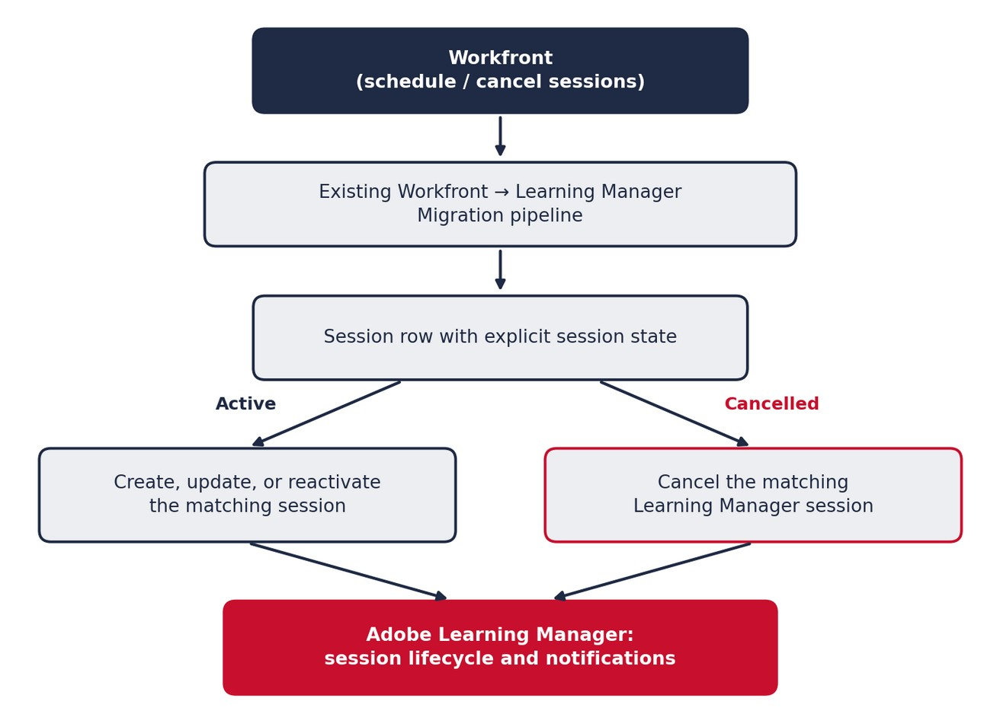

# Trigger annullamento/aggiornamento ALM-Workfront

## Panoramica

Adobe Learning Manager (Learning Manager) ora può annullare e riattivare le sessioni ILT/VILT (Virtual Instructor-Led/istruttore) condotte da istruttore e basate sulle modifiche apportate in Workfront. Se l’organizzazione pianifica le sessioni in Workfront e le porta in Learning Manager tramite la migrazione da Workfront a Learning Manager, puoi impostare lo stato di ogni sessione su Attivo o Annullato nei dati di migrazione. Learning Manager applica quindi la modifica come se un amministratore avesse annullato la sessione nell’interfaccia utente.

L’annullamento di una sessione tramite migrazione funziona come l’annullamento dall’interfaccia utente di Learning Manager. L&#39;unica differenza deliberata è la riattivazione, descritta in [Riattivare una sessione annullata](#reactivate-a-cancelled-session).

### Il requisito

Gli aggiornamenti a una sessione, come data e ora, istruttore, posizione o collegamento e capacità, già passano da Workfront a Learning Manager attraverso la migrazione. Gli annullamenti non sono stati eseguiti. Quando una sessione veniva annullata in Workfront, Learning Manager non disponeva di alcun modo per saperla, il che causava i seguenti problemi:

* Gli Allievi sono rimasti iscritti a una sessione che non veniva più eseguita, generando confusione e no-show.
* Gli amministratori dovevano ripetere manualmente l’annullamento in Learning Manager.
* Workfront e Learning Manager non erano più sincronizzati, il che ha compromesso Workfront come fonte di verità per la pianificazione.

### Come funziona

1. Un responsabile consegna annulla una sessione in Workfront.
1. La riga della sessione nei dati di migrazione include la nuova colonna dello stato della sessione, impostata su Annullato.
1. La migrazione viene eseguita da un amministratore di sistema tramite l’API.
1. Learning Manager contrassegna la sessione corrispondente come annullata e invia le stesse notifiche inviate dall’interfaccia utente in caso di annullamento.

>[!NOTE]
>
>Questa funzione estende il processo di migrazione esistente anziché aggiungere un secondo percorso di integrazione in tempo reale.

### Flusso di lavoro completo

Nel diagramma seguente viene illustrato lo spostamento di una riga di sessione da Workfront a Learning Manager.

## Casi d’uso

I seguenti ruoli sono coinvolti in un annullamento che inizia in Workfront.

### Ruoli interessati

| Ruolo | Descrizione |
|---|---|
| Responsabile consegna | Pianifica e gestisce il calendario dei corsi di formazione in Workfront, inclusa l’annullamento delle sessioni. I manager di erogazione non utilizzano l’interfaccia utente di Learning Manager. La migrazione è l’unico percorso tramite il quale l’annullamento raggiunge Learning Manager. |
| Amministratore di sistema | Esegue la migrazione tramite l’API. Questo ruolo gestisce la pipeline da Workfront a Learning Manager ed è separato dal responsabile della distribuzione e dall’amministratore di Learning Manager. |
| Amministrazione | Gestisce i dati dei corsi e delle sessioni nell’interfaccia utente di Learning Manager. Gli amministratori non devono più annullare manualmente le sessioni dopo che hanno ricevuto informazioni su una modifica in Workfront. |
| Autore | È il proprietario del contenuto del corso e della sessione nell’interfaccia utente di Learning Manager. |
| Istruttore | Assegnato alle sessioni. Gli istruttori visualizzano lo stato della sessione corretto e ricevono una notifica quando una sessione che hanno istruito viene annullata. |
| Allievo | È iscritto a una sessione tramite Learning Manager. Gli Allievi vengono informati immediatamente dell’annullamento della sessione. |

### Scenari comuni

| Scenario | Attività svolte | Risultato |
|---|---|---|
| Una sessione viene annullata in Workfront, ad esempio perché una risorsa non è disponibile o un fornitore ha un problema. | Imposta lo stato della sessione su Annullato nella riga di migrazione per la sessione ed esegui la migrazione. | La sessione viene annullata in Learning Manager e gli utenti interessati ricevono una notifica. |
| Dettagli di una modifica di sessione attiva in Workfront. | Includi i valori modificati nella riga di migrazione. Imposta lo stato della sessione su Attivo o lascialo vuoto. | La sessione viene aggiornata. Learning Manager invia un’e-mail con aggiornamento della sessione. |
| Una sessione annullata viene ripristinata in Workfront. | Imposta lo stato della sessione su Attivo nella riga di migrazione ed esegui la migrazione. | La sessione diventa attiva e può essere modificata e annullata di nuovo. |
| I dettagli aggiornati vengono inviati per una sessione annullata senza impostare lo stato su Attivo. | Non è richiesta alcuna azione da parte dell’utente. | La sessione rimane annullata, la riga restituisce un errore di convalida e nessun dettaglio viene modificato. |
| Una riga di migrazione non include uno stato sessione. | Lasciare vuota la colonna o ometterla. | Lo stato corrente della sessione in Learning Manager viene lasciato invariato. |

## Funzioni principali

* **Colonna dello stato della sessione.** Lo schema di migrazione include un campo facoltativo per lo stato della sessione che supporta Attivo e Annullato.
* **Annullamento tramite migrazione.** Quando lo stato di una riga è Annullato, la sessione corrispondente in Learning Manager viene annullata. Learning Manager utilizza la stessa chiave di corrispondenza già utilizzata dalla migrazione per creare e aggiornare le sessioni.
* **Nessun lavoro manuale in Learning Manager.** Gli amministratori non devono annullare nuovamente la sessione nell&#39;interfaccia utente.
* **Stesso comportamento dell&#39;annullamento nell&#39;interfaccia utente.** La gestione delle iscrizioni, la visibilità rivolta agli Allievi, i report, l’audit trail e le notifiche corrispondono all’annullamento dall’interfaccia utente.
* **Riattivazione.** È possibile riimpostare una sessione annullata su Attiva impostando lo stato esplicitamente nei dati di migrazione.
* **Protezione per le sessioni annullate.** La migrazione non modifica i dettagli di una sessione annullata a meno che la riga non imposti esplicitamente lo stato su Attivo.
* **Compatibilità con le versioni precedenti.** La colonna relativa allo stato è facoltativa e i file di migrazione esistenti continueranno a funzionare senza modifiche.
* **Notifiche complete.** Allievi, Istruttori, Amministratori, Autori e Manager ricevono le stesse e-mail di annullamento che ricevono per un annullamento dall’interfaccia utente.

## Stati della sessione

Ogni sessione in Learning Manager è in uno di due stati.

| Stato | Significato |
|---|---|
| Attivo | Stato predefinito. La sessione è in diretta e gli Allievi possono iscriversi e parteciparvi. |
| Annullato | Sessione annullata. Gli Allievi, gli Amministratori, gli Autori e i Manager iscritti ricevono una notifica di annullamento dall’interfaccia utente. |

### Norme di transizione dello Stato per la migrazione

Nella tabella seguente vengono illustrate le operazioni eseguite durante l&#39;elaborazione di una riga di migrazione. Learning Manager identifica la sessione utilizzando la chiave corrispondente già utilizzata dalla migrazione per la creazione e l’aggiornamento.

| Stato corrente in Learning Manager | Stato della sessione nella riga di migrazione | Risultato |
|---|---|---|
| La sessione non esiste | Attivo o vuoto | La sessione viene creata come attiva. |
| Attivo | Attivo o vuoto | La sessione rimane attiva. Vengono applicati i valori modificati nella riga. |
| Attivo | Annullato | La sessione viene annullata e vengono inviate notifiche. |
| Annullato | Annullato | La riga viene ignorata. Impossibile annullare nuovamente una sessione annullata. |
| Annullato | Attivo | La sessione viene riattivata. Vengono applicati i valori modificati nella riga. |
| Annullato | Vuoto | Sessione annullata. Se i valori della riga sono stati modificati, viene restituito un errore di convalida e non vengono modificati i dettagli. |

### Regole per la colonna Stato sessione

* La colonna è facoltativa su ogni riga.
* Quando la colonna è vuota, la sessione verrà aggiornata ad Attiva.
* Una sessione diventa nuovamente attiva tramite migrazione solo quando la colonna indica esplicitamente Attiva.

Utilizzare uno dei valori seguenti nella colonna dello stato della sessione:

* `state = Active`
* `state = Cancelled`

>[!NOTE]
>
>L’intestazione di colonna esatta e i valori accettati vengono confermati. Utilizzare i nomi specificati nella documentazione di migrazione.

## Aggiornamenti per le sessioni annullate

Non è possibile aggiornare i dettagli di una sessione annullata tramite migrazione. Se una riga per una sessione annullata contiene valori modificati e non imposta lo stato su Attivo, Learning Manager restituisce un errore di convalida, lascia la sessione annullata e non applica né memorizza i dettagli modificati. Learning Manager non invia un’e-mail aggiornata per la sessione per il tentativo.

### Annullare una sessione utilizzando la migrazione

Utilizza questa procedura quando una sessione è stata annullata in Workfront e vuoi che Learning Manager rifletta la modifica.

**Prima di iniziare**

* La sessione esiste già in Learning Manager, importata tramite la migrazione da Workfront a Learning Manager.
* Conosci la chiave di corrispondenza utilizzata dalla migrazione per identificare la sessione.

1. In **Workfront**, annulla la sessione.
1. Nel file CSV della sessione utilizzato per la migrazione, individua la riga della sessione. Assicurati che la chiave corrispondente sia la stessa utilizzata al momento della creazione della sessione.
1. Nella colonna Stato sessione immettere **Annullato**.
1. Esegui la migrazione tramite l’API.
1. In Learning Manager, verifica che la sessione sia annullata.

Learning Manager contrassegna la sessione come annullata, gestisce gli Allievi iscritti come fa per l’annullamento dall’interfaccia utente e invia le notifiche di annullamento. Non è richiesta alcuna azione nell’interfaccia utente di Learning Manager.

>[!NOTE]
>
>Se la sessione è già stata annullata, Learning Manager salta la riga.

### Aggiornare una sessione attiva

Per una sessione attiva, il comportamento di aggiornamento della migrazione esistente rimane disponibile. Imposta lo stato della sessione su Attivo o lascialo vuoto e includi i valori modificati nella riga. Puoi continuare ad aggiornare dettagli quali data e ora, istruttore, posizione o collegamento e capacità tramite la pipeline di migrazione.

Attivo mantiene il comportamento di creazione e aggiornamento esistente. Annullato richiama lo stesso annullamento di sessione fornito dall’interfaccia utente, tramite la migrazione CSV della sessione.

### Riattivare una sessione annullata

Una sessione annullata ritorna allo stato attivo solo quando lo stato viene impostato esplicitamente su Attivo. Puoi riattivare una sessione tramite migrazione o modificandola nell&#39;interfaccia utente.

1. Nel file CSV della sessione, individua la riga della sessione annullata. Assicurati che la chiave corrispondente sia la stessa utilizzata al momento della creazione della sessione.
1. Nella colonna Stato sessione immettere Attivo.
1. (Facoltativo) Aggiornare eventuali altri valori nella riga che si desidera modificare, ad esempio data e ora, istruttore, posizione o collegamento o capacità.
1. Esegui la migrazione tramite l’API.

La sessione diventa attiva e i relativi dettagli possono essere modificati. Una sessione riattivata tramite migrazione o tramite l’interfaccia utente può essere annullata di nuovo tramite uno dei percorsi.

>[!IMPORTANT]
>
>Se si inviano i dettagli della sessione aggiornata per una sessione annullata senza impostare lo stato su Attivo, la sessione rimane annullata e la riga restituisce un errore di convalida.

## Notifiche

Learning Manager invia ogni e-mail che invia per l’annullamento dall’interfaccia utente quando una sessione viene annullata tramite migrazione. La copertura dei destinatari non viene ridotta e il contenuto utilizza lo stesso modello, pertanto i destinatari non possono indicare in che modo è stata avviata l’annullamento.

Di seguito sono riportati i destinatari applicabili alla sessione.

| Destinatario | Notifica |
|---|---|
| Allievi | Agli Allievi iscritti alla sessione viene comunicato che la sessione è stata annullata. |
| Istruttori | Agli istruttori assegnati alla sessione viene notificato l’annullamento. |
| Manager | I Manager ricevono la notifica di annullamento. |

### E-mail per le sessioni annullate

Una sessione annullata non genera e-mail aggiornate in base alla sessione. Quando una sessione viene annullata, le modifiche apportate a data e ora, istruttore, posizione o collegamento e capacità non attivano l’e-mail aggiornata per la sessione. A una sessione annullata si applicano solo le notifiche di annullamento e riattivazione.

## Considerazioni e limitazioni

* Poiché la funzione utilizza la migrazione, un annullamento effettuato in Workfront raggiunge Learning Manager durante l’esecuzione della migrazione. L’annullamento in tempo reale basato su webhook non è supportato.
* La migrazione non può modificare i dettagli di una sessione annullata. Per modificarle, impostate prima lo stato su Attivo.
* La colonna relativa allo stato della sessione è facoltativa. Le righe che omettono non modificano mai lo stato di una sessione.
* Questa funzione estende l’integrazione di migrazione esistente. Non aggiunge un secondo percorso di integrazione in tempo reale.
* La pianificazione o l’attivazione della migrazione dipende dagli strumenti utilizzati dall’organizzazione per eseguirla. Questa guida non definisce un programma fisso.
* I responsabili consegna funzionano solo in Workfront. Non hanno bisogno di accedere all’interfaccia utente di Learning Manager per annullare una sessione.

## Misure di successo

| Misura | Target |
|---|---|
| Annullamenti replicati manualmente dagli amministratori o dall’assistenza clienti | Ridotto a 0 entro un ciclo di rilascio completo dopo l’avvio. |
| Annullamenti di Workfront riflessi in Learning Manager | 100% degli eventi di annullamento elaborati in un ciclo di migrazione. |
| Parità delle notifiche tra l’interfaccia utente e gli annullamenti della migrazione | 0 vuoti nella copertura dei destinatari (amministratori, autori, manager e allievi) e 0 e-mail di aggiornamento non necessarie per le sessioni annullate. |

## Risoluzione dei problemi

| Il problema | Causa prevista o possibile | Azione |
|---|---|---|
| Una sessione rimane attiva dopo essere stata annullata in Workfront. | La migrazione non ha ancora elaborato l’annullamento o la riga di migrazione non presenta lo stato Annullato esplicito. | Verifica l’input di migrazione e il risultato dell’elaborazione. |
| I dettagli di una sessione annullata non cambiano. | Comportamento previsto durante la sospensione della sessione. | Riattiva la sessione impostando lo stato su Attivo, quindi applica le modifiche. |
| Nessuna e-mail aggiornata alla sessione viene inviata per una sessione annullata. | Comportamento previsto. Le e-mail di aggiornamento ordinarie vengono soppresse per le sessioni annullate. | Utilizza il ciclo di vita di annullamento e riattivazione invece di un aggiornamento per i soli dettagli. |
| Riga di annullamento ignorata. | Sessione corrispondente in Learning Manager già annullata. | Non è necessaria alcuna ulteriore cancellazione. Riattiva prima la sessione se deve tornare attiva. |
| Un destinatario ha ricevuto lo stesso messaggio e-mail di annullamento di un’interfaccia utente. | Comportamento previsto. L’annullamento della migrazione è progettato per corrispondere all’interfaccia utente. | Non è richiesto alcun intervento. |
| Il comportamento non è chiaro quando lo stato della sessione è vuoto. | I requisiti di origine sono in conflitto con la gestione dello stato vuoto. | Conferma il comportamento di rilascio prima di affidarti a uno stato vuoto per qualsiasi transizione. |
