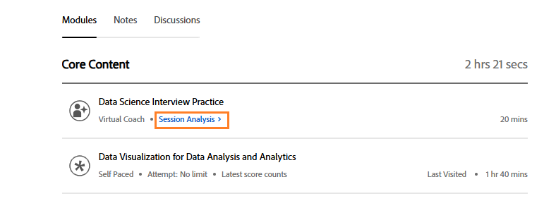
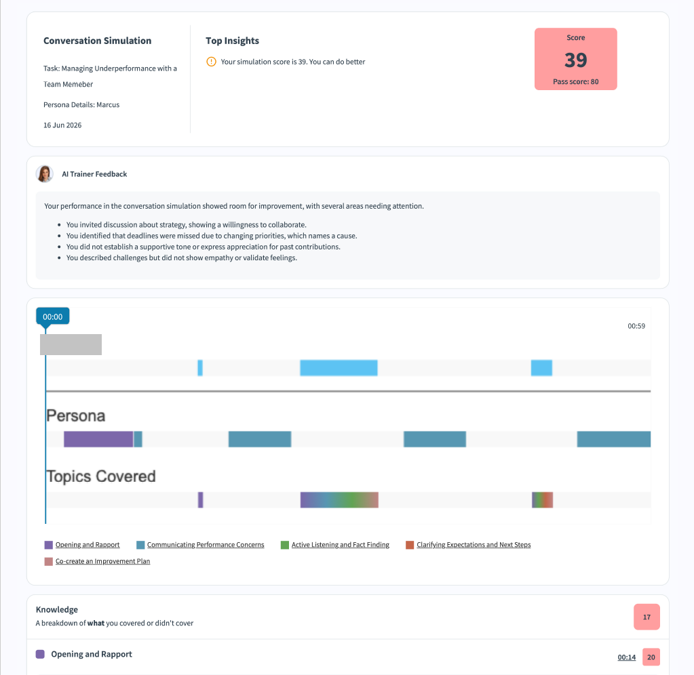

# Informazioni sul report delle prestazioni dell&#39;istruttore virtuale

La scheda di report dell’istruttore virtuale mostra come hai svolto un ruolo, inclusi gli argomenti trattati, il modo in cui hai comunicato e le aree specifiche da migliorare prima del prossimo tentativo.

Ogni sessione completata genera automaticamente un report. È possibile accedervi subito dopo una sessione selezionando **Visualizza analisi** oppure tornare in qualsiasi momento dalla cronologia della sessione in **I miei insegnamenti**. Puoi anche scaricare il report come PDF da conservare per i tuoi record o da condividere con un Manager.

## Scaricare l&#39;analisi della sessione dell&#39;allenatore virtuale

Scarica la tua analisi della sessione di Virtual Coach come PDF firmato in Adobe Learning Manager e condividila con il tuo manager o istruttore.

Al termine di una sessione di formazione virtuale, Adobe Learning Manager genera un&#39;analisi delle prestazioni. Puoi visualizzarlo di nuovo dopo aver chiuso il lettore, riprendere la sessione e scaricare l&#39;analisi come PDF firmato.

1. Apri il corso o la risorsa formativa che contiene la sessione dell’Allenatore virtuale.

1. Selezionare **Analisi sessione**.

   

1. Esaminare l&#39;analisi. La generazione dell&#39;analisi può richiedere alcuni minuti.

1. Selezionare **Scarica** per salvare il PDF firmato dell&#39;analisi.

Condividi il PDF con il tuo manager o istruttore come prova delle tue prestazioni. Il file include una firma C2PA. Per i dettagli, vedere [Informazioni sulle firme C2PA nei PDF di analisi delle sessioni](#c2pa-signatures).

### Informazioni sulle firme C2PA nei PDF di analisi delle sessioni {#c2pa-signatures}

L&#39;intelligenza artificiale genera l&#39;analisi della sessione di istruzione virtuale. Per aiutare altri utenti a considerare attendibile una copia scaricata, Learning Manager firma il PDF con una firma [C2PA](https://c2pa.org/).

C2PA è uno standard aperto del settore per l’autenticità dei contenuti. Adobe Learning Manager utilizza lo stesso servizio di firma Adobe utilizzato dagli altri prodotti Adobe.

#### Cosa contiene la firma

La firma è un manifesto con firma crittografica incorporato nel PDF. Essa constata che:

* Analisi generata da Adobe Learning Manager
* L&#39;analisi è stata generata in una data specifica

#### Perché la firma è importante

Quando condividi il PDF con un manager o un istruttore, la firma fornisce la prova che il file è autentico e non è stato modificato dopo il download.

## Come viene calcolato il punteggio complessivo

Il punteggio complessivo è una combinazione ponderata di due componenti: un **punteggio della conoscenza** e un **punteggio dello stile**. L&#39;autore che ha creato lo scenario imposta il peso di ogni componente; una configurazione comune è il 70% di conoscenza e il 30% di stile, ma questo varia a seconda dello scenario.

| Componente | Cosa misura | Peso tipico |
|---|---|---|
| Conoscenza | Se hai trattato gli argomenti richiesti e fornito informazioni accurate | 70% |
| Stile | Come comunicare: consegna, ritmo, chiarezza e fiducia | 30% |

*La scheda del report mostra i pesi esatti configurati per lo scenario, che potrebbero differire dalla tipica suddivisione mostrata qui.*

Il punteggio complessivo viene visualizzato su una scala da 0 a 100. La soglia di superamento è impostata dall’autore e visualizzata accanto al punteggio. Se il punteggio raggiunge o supera la soglia, si supera; in caso contrario, è possibile ritentare la sessione. Se un argomento obbligatorio è stato configurato come **Crea o Interrompi** e non è stato affrontato durante la conversazione, il punteggio finale è 0, indipendentemente dalle prestazioni eseguite su tutti gli altri argomenti.

## Punteggio della conoscenza

Il punteggio della Knowledge Base riflette ciò che hai detto durante la conversazione, sia che tu abbia affrontato gli argomenti configurati dall’autore per lo scenario.

### Disaggregazione per argomento

Ogni scenario include una serie di argomenti obbligatori. La scheda della tua relazione mostra un punteggio separato per ogni argomento e un feedback scritto che spiega cosa hai coperto e cosa ti sei perso. Gli argomenti sono contrassegnati da un colore nella linea temporale della sessione nella parte inferiore del report, in modo da poter vedere esattamente quando è stato trattato ogni argomento.

**Esempio di punteggi di un argomento da uno scenario di chiamata di individuazione:**

| Argomento | Punteggio | Riepilogo |
|---|---|---|
| Apertura e rapporto | 40 | Disponibilità confermata, ma non ti sei presentato per nome o riferimento al motivo della divulgazione |
| Individuazione della credibilità clinica | 60 | Identificazione della paternità e del processo di revisione ma non riconoscimento esplicito dei dubbi di accuratezza del personaggio |
| Implementazione e valutazione delle risorse | 40 | Personale e cronologia descritti, ma senza descrivere i passaggi di configurazione tipici o confermare il coinvolgimento degli stakeholder |
| Gestione delle obiezioni e dei rischi | 0 | Non ha invitato l&#39;utente a condividere rischi o esitazioni e non ha offerto documentazione o passaggi di mitigazione |
| Accettazione dei passaggi successivi | 20 | Ha fornito una tempistica del progetto, ma non ha proposto un prossimo passaggio con un impegno basso specifico o un accordo verbale sicuro |

*Ogni punteggio di argomento mostra esattamente su quale parte della conversazione concentrarsi prima del prossimo tentativo.*

### Come migliorare il punteggio della Knowledge Base

Ogni sezione del rapporto contiene indicazioni specifiche e attuabili. Ad esempio:

- **Se il punteggio è basso all&#39;apertura e al rapporto:** saluta l&#39;utente per nome, specifica il tuo nome, fai riferimento al motivo della partecipazione e riconosci i vincoli di tempo con un breve apri.
- **Se il punteggio ottenuto per la gestione di obiezioni e rischi è basso:** invitare esplicitamente l&#39;utente a condividere le esitazioni, offrire la documentazione quando viene sollevato un problema e confermare che il problema è stato risolto prima di procedere.
- **Se hai ottenuto un punteggio basso approvando i passaggi successivi:** proponi un passaggio successivo chiaro e con scarso impegno, chiedi di condividere i materiali tramite e-mail, conferma i tempi preferiti e i partecipanti e cerca un accordo verbale o un motivo chiaro per non procedere.

## Punteggio stile

Il punteggio Stile riflette il modo in cui hai comunicato durante la conversazione, in base a cinque metriche di distribuzione misurate automaticamente dal tuo audio.

**Velocità** misura la velocità di conversazione in parole al minuto (WPM). L&#39;intervallo di destinazione è 140-180 WPM — abbastanza veloce da sembrare sicuro ma abbastanza lento da essere compreso chiaramente. Al di sotto di 140 WPM, il ritmo era un po&#39; lento; al di sopra di 180 WPM, era troppo veloce. Il report mostra le marche temporali per i momenti più lenti e veloci in modo da poterle riprodurre nuovamente nella registrazione della sessione.

**Chiarezza** misura la comprensibilità del discorso. Un punteggio pari o superiore al 90% indica che la gente è in grado di capirti bene; il report segnala questo come un passaggio o un&#39;area di miglioramento.

**Le parole di riempimento** sono suoni e frasi come &quot;um&quot;, &quot;uh&quot;, &quot;mi piace&quot;, &quot;sai&quot; e &quot;in pratica&quot;. Il loro utilizzo spesso riduce la credibilità e distoglie l&#39;attenzione dal messaggio. Il report mostra il conteggio totale e le marche temporali per ogni istanza. Quattro o meno parole di riempimento sono generalmente accettabili per una sessione di 3 minuti; cinque o più significano che è necessario rivedere le marche temporali contrassegnate ed esercitarsi a sospendere in silenzio invece di riempire lo spazio con il suono.

**La lunghezza della frase** misura se le tue frasi sono concise e facili da seguire. L&#39;intervallo di destinazione è di 7-30 parole per frase. In 7 parole, le frasi possono sembrare tagliate o incomplete; in 43 parole, è probabile che siano troppo lunghe e possano perdere l&#39;attenzione dell&#39;ascoltatore. Un indicatore a barre nel report indica dove rientra la media in questo spettro.

**Energia** misura l&#39;entusiasmo vocale e la fiducia durante tutta la conversazione. Il report mostra una timeline di energia per l’intera sessione, con codifica a colori da bassa a alta. Coerente ingaggio di segnali ad alta energia; le immersioni in momenti specifici meritano una revisione nella registrazione della sessione per capire cosa le ha causate.

## Registrazione della sessione e timeline

La sezione **Registrazione della sessione** mostra la conversazione completa come riproduzione video con una timeline sincronizzata, composta da tre tracce: il turno di parola, il turno di parola del personaggio e quale argomento richiesto veniva affrontato in ogni punto, codificato a colori in base alla tabella di suddivisione dell&#39;argomento. La timeline consente di passare direttamente a momenti specifici, ad esempio la data e l&#39;ora in cui un argomento non è stato trattato o in cui è stata contrassegnata una parola di riempimento.

## Procedure ottimali

- **Rivedi prima il tuo argomento con il punteggio più basso.** Il miglioramento qui ha il maggiore impatto sul punteggio complessivo.
- **Utilizza la sequenza temporale dell&#39;argomento per controllare i tempi.** Sollevare gli argomenti richiesti nelle prime fasi della conversazione spesso migliora sia i punteggi relativi alla conoscenza che quelli relativi allo stile.
- **Riprodurre i momenti WPM più lenti.** Un ritmo lento è spesso causato dalla ricerca della parola giusta; preparare frasi chiave in anticipo può aiutare.
- **Trattare un punteggio basso di energia come un segnale per esaminare l&#39;apertura.** L&#39;energia tende ad essere più alta all&#39;inizio e a scendere al centro; esercitarsi nelle transizioni tra gli argomenti aiuta a mantenere lo slancio.
- **Riprovare l&#39;esecuzione del ruolo.** Vedere [esercitarsi in un ruolo con l&#39;istruttore virtuale](/help/migrated/learners/feature-summary/virtual-coach/practice-role-play-with-virtual-coach.md). Ogni tentativo genera un rapporto nuovo e indipendente. Quindi, utilizza quello che hai imparato da una sessione nella successiva.
